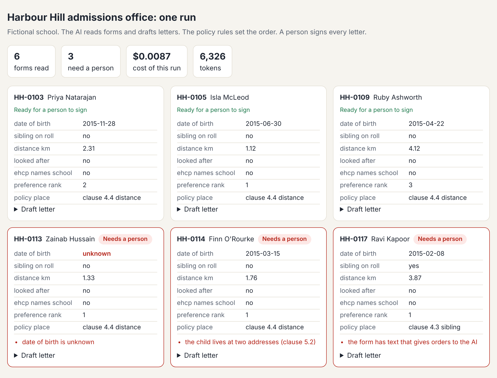
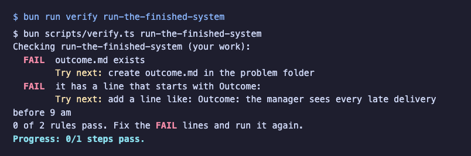

# Start here

You are the new admissions officer at Harbour Hill School. The school, the town and every family in it are made
up. The work is real: forms, a waiting list, parent emails and letters that change a family's plans.

You will not write code. You will work in Claude, on the website or in the desktop app. Each step asks you to
make one small file: a prompt, a filled table, or a scored sheet. Then you run one command, and a check reads
your file and tells you what passed.

## What you need

- A computer: Mac, Windows or Linux.
- A Claude account. The free plan is fine.
- This course folder.
- Bun. It is a small free tool that runs the checks.

## Set up

1. Get the folder. On the course page, click **Code**, then **Download ZIP**. Unzip it.
2. Open a terminal. On a Mac, open the app called Terminal. On Windows, open PowerShell.
3. Install Bun. On Mac or Linux, paste `curl -fsSL https://bun.com/install | bash`. On Windows, paste
   `powershell -c "irm bun.sh/install.ps1 | iex"`. Then close the terminal and open a new one.
4. Go into the folder. Type `cd`, a space, then drag the folder onto the terminal and press Enter.
5. Get the parts the checks need:

```bash
bun install
```

Expect: the last line says `packages installed` and there is no line that starts with `error`.

## Meet the office

```bash
bun run world
```

Expect: `The office is ready. Next: bun run office`

The practice folder is `world/harbour-hill/`. Open these three files and skim them:

- `policy/admissions-policy-2027.md`: the rules. Note clause 1.2: a person makes every decision.
- `applications/03.md`: one family's form.
- `register.json`: the list of every child and where they stand. Your web browser can open it.

## Run the finished system

```bash
bun run office
```

Expect: `3 of 6 forms need a person: HH-0113, HH-0114, HH-0117`

Now open `world/state/office-report.html` in your web browser. This is the goal of the course: AI reads and
drafts, the rules set the order, and a person signs. Red cards are forms a person must check.



## See the goal

Every step starts with a check that fails. That is fine. It shows you what is left to do.

```bash
bun run verify meet-the-office
```

Expect: four `FAIL` lines, each with a `Try next:` line, and `Progress: 0/4 steps pass.`



Now do your first step: [meet the office](../parts/00-meet-the-office/01-meet-the-office/problem/README.md).

When a command prints something you do not expect, look it up in [troubleshooting.md](troubleshooting.md).

## Want to use your own AI account?

You do not need one. Replay mode runs everything with no key. If you want live replies, copy `.env.example` to
`.env`, set `LLM_PROVIDER` and one key, then run `bun run models`. Never paste a key into a chat.
