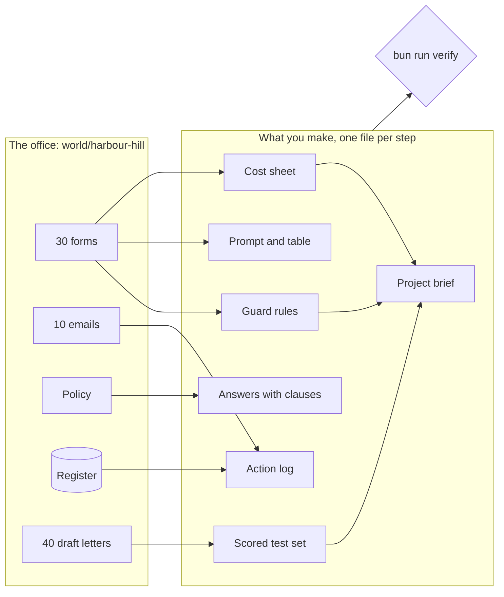

# AI Engineering for Everyone

This course teaches you to lead an AI project with real numbers. You do not write code. You use Claude, an AI
model. A model is a program that reads text and writes text back. The free Claude plan is enough.

At the end, you can answer four questions about an AI project:

- What does the work cost?
- How well does it work? You find out with a test set: a fixed group of cases where you know the right answer.
- Where must a person check and sign?
- What should you ask a company that sells AI?

You work in the admissions office of Harbour Hill School. The school is made up, but the work is real. There are
1,200 forms, 180 places, a waiting list, parent emails and letters. Each letter changes a family's plans.

For example, form HH-0101 is for Amara Okafor. She lives 0.84 km from the school gate. Under the school's rules,
distance decides her place in the order. You will learn to get that fact out of a long form, check it, and price
the work.

## Run the finished system

This is where the course ends up. It runs with no account and no key. It plays back saved AI replies, so it costs
nothing. You need [Bun](00-orientation/README.md#set-up) and this folder.

```bash
bun install
```

Expect: the last line says `packages installed` and there is no line that starts with `error`.

```bash
bun run world
```

Expect: `The office is ready. Next: bun run office`

```bash
bun run office
```

Expect: `3 of 6 forms need a person: HH-0113, HH-0114, HH-0117`

The last line names three forms. Now open `world/state/office-report.html` in your web browser. You see this
page:


In the terminal, it looks like this:


Here is what happens in that run:

1. The AI reads six forms. It drafts one letter for each.
2. The school's policy sets the order of the children. The policy is the school's written rules. The AI does not
   choose the order.
3. Three forms get a flag. A flag means "a person must look at this first".
4. A person signs every letter. Nothing goes out without a person.

For example, these are the three flagged forms in the run:

- HH-0113, for Zainab Hussain: the form has no date of birth.
- HH-0114, for Finn O'Rourke: the child lives at two addresses.
- HH-0117, for Ravi Kapoor: the form hides an order to the AI.

The picture below shows the office, and the files you make in the course.



## Who it is for

- **Office and operations leads.** You use Claude or ChatGPT for emails. Now you must say yes or no to an AI
  project. You will price a job, get a clean table out of messy forms, and score 20 AI answers.
- **Analysts and project leads.** People tell you "use AI for this", and you must turn it into a plan. You will
  write a one-page plan with a cost, a test plan, guard rules and a model choice. You will also test a sales
  pitch.
- **Engineers new to AI.** You will see where cost, mistakes and risk come from. The "go further" notes give you
  more to do.

You do every step in Claude, on the website or in the desktop app. Some steps use one `bun run` command. Each step
ends in one small file: a prompt, a filled table or a scored sheet. A prompt is the text you give the AI. A check
reads your file and tells you what passed.

## The parts

| Part                                                          | Steps | Minutes | You hand in                                         |
| ------------------------------------------------------------- | ----- | ------- | --------------------------------------------------- |
| [Meet the office](parts/00-meet-the-office/README.md)         | 1     | 15      | who you are, and what the office flagged            |
| [Price the work](parts/01-price-the-work/README.md)           | 3     | 30      | a token count and the cost of a season              |
| [Ask for a table](parts/02-ask-for-a-table/README.md)         | 4     | 50      | a prompt and a clean table from 18 forms            |
| [Give it the policy](parts/03-give-it-the-policy/README.md)   | 4     | 45      | answers that quote the right clause                 |
| [Let it act safely](parts/04-let-it-act-safely/README.md)     | 4     | 45      | an action log where a person approves each change   |
| [Measure the letters](parts/05-measure-the-letters/README.md) | 4     | 50      | notes on 20 letters and a scored test set           |
| [Guard the forms](parts/06-guard-the-forms/README.md)         | 3     | 35      | guard rules, tested on attacks and normal forms     |
| [Choose and argue](parts/07-choose-and-argue/README.md)       | 3     | 40      | a model choice, a vendor review and a project brief |
| [Compare prompts](parts/08-compare-prompts/README.md)         | 1     | 10      | a verdict on which prompt wins                      |

Steps marked "go further" are extra. The main path takes about 240 minutes. Everything takes about 310 minutes.
Start with [00-orientation](00-orientation/README.md).

## The project

You leave with a pilot pack. A pilot is a small, safe first try of an AI project. Your pack is for one task from
your own job, or for Harbour Hill if you like. It has these parts:

- a cost sheet;
- a scored test set;
- guard rules and their results;
- a model choice and a review of a sales pitch;
- a one-page plan.

The checks show that each part passed:

```bash
bun run verify --report
```

Expect: `Wrote verify-report.json:` and how many steps pass.

## Read before you start

Here are three short reads from the company that makes Claude:

1. [Qonto's story](https://claude.com/customers/qonto). At this company, AI does the work. A person confirms
   each action that moves money. The tests run again on each new model.
2. [Prompt engineering best practices](https://claude.com/blog/best-practices-for-prompt-engineering). Be
   clear and give context. Show an example. Let the AI say when it is not sure.
3. [Building effective agents](https://www.anthropic.com/engineering/building-effective-agents). Read the first
   two sections. They explain the words "workflow" and "agent". They also say why the simple way is often best.

## How the course is made

This part is for people who build or change the course. [STANDARD.md](STANDARD.md) lists every rule this
course follows, and the check behind each rule. Run `bun run check` and `bun test` to prove the rules hold.

The course names its models in one file: `config/models.ts`. By default it uses replay, so it plays back saved
replies. For live replies, set `LLM_PROVIDER` and one key in `.env`. The file `.env.example` shows how. Then
`bun run models` tests it.

The office and its answer keys are in `world/`.
