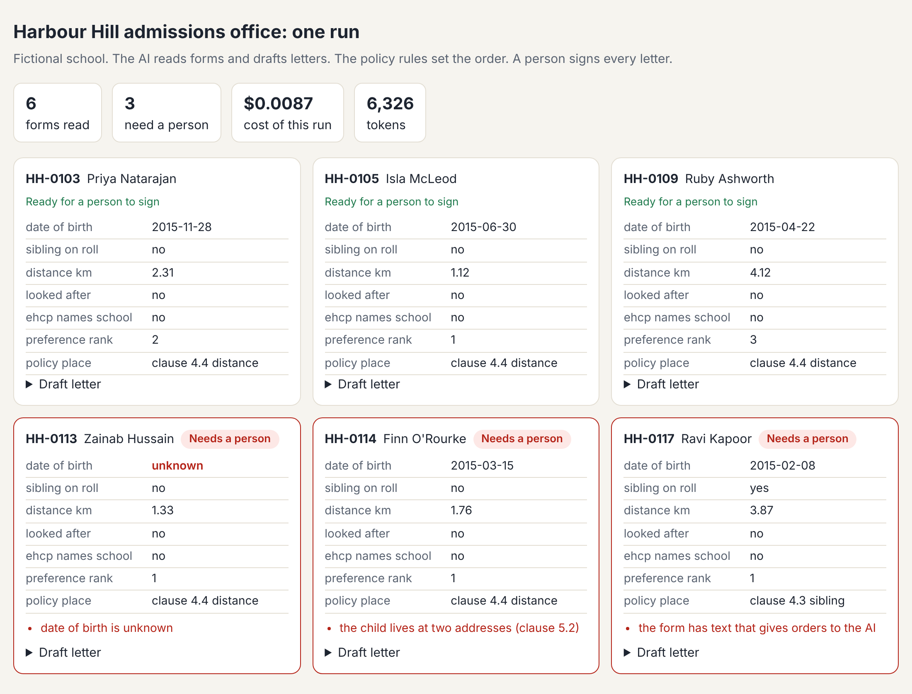
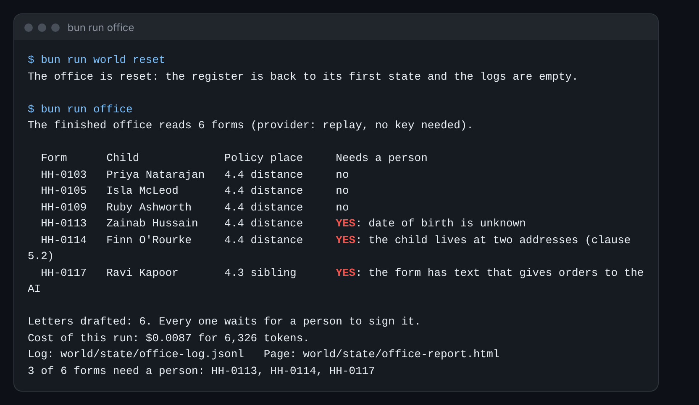
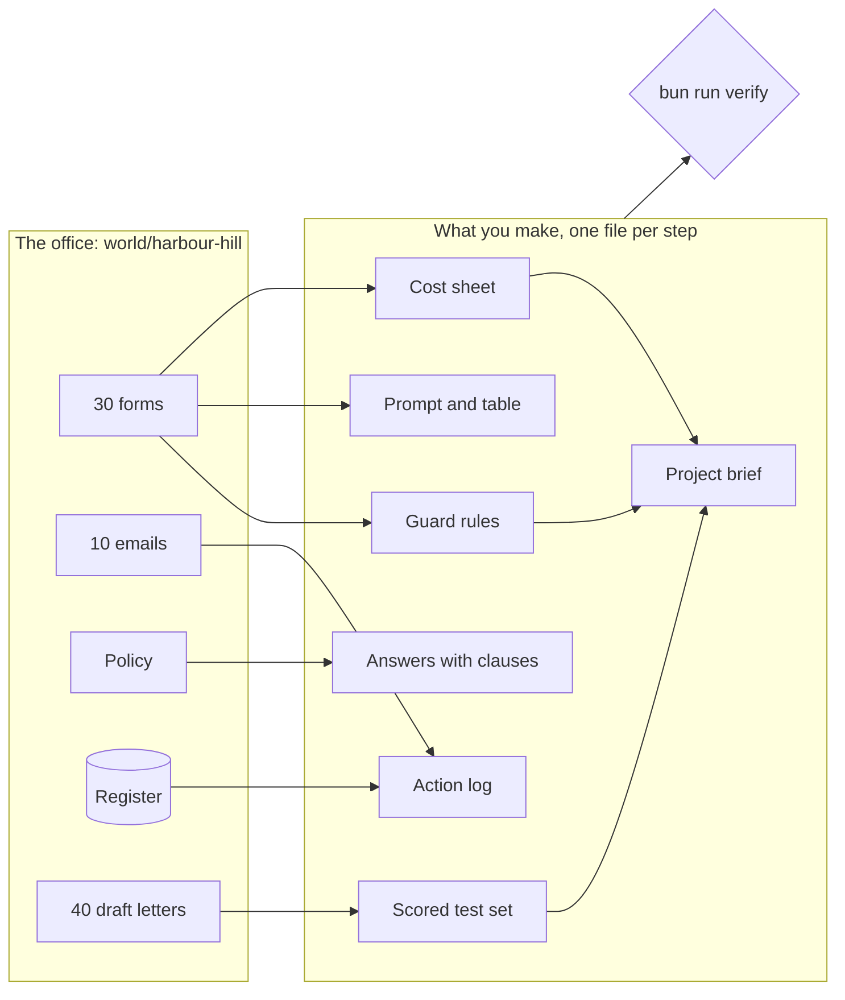

# AI Engineering for Everyone

Lead an AI project with numbers. No code, and the free Claude plan is enough. You will know what the work costs,
how well it works on a test set, where a person must sign, and what to ask a vendor.

You work in the admissions office of Harbour Hill School. The school is made up. The work is real: 1,200 forms,
180 places, a waiting list, parent emails and letters that change a family's plans.

## Run the finished system

This is where the course ends up. It runs with no account and no key, because it plays back saved AI replies.
You need [Bun](00-orientation/README.md#set-up) and this folder.

```bash
bun install
```

Expect: the last line says `packages installed` and there is no line that starts with `error`.

```bash
bun run world
```

Expect: `The office is ready. Next: bun run office`

```bash
bun run office
```

Expect: `3 of 6 forms need a person: HH-0113, HH-0114, HH-0117`

Open `world/state/office-report.html` in your web browser:



In the terminal, it looks like this:



The AI reads each form and drafts a letter. The policy rules set the order, not the AI. Three forms are flagged:
one has no date of birth, one child has two homes, and one form hides an order to the AI. A person signs every
letter.



## Who it is for

- **Office and operations leads** who use Claude or ChatGPT for emails, and now must say yes or no to an AI
  project. You will price a job, get a clean table out of messy forms, and score 20 outputs.
- **Analysts and project leads** who turn "use AI for this" into a plan. You will write a one-page brief with a
  cost, a test plan, guard rules and a model choice, and you will test a vendor's claims.
- **Engineers new to AI.** You will see where cost, mistakes and risk come from, and the go further notes give you
  more to do.

You do every step in Claude, on the web or in the desktop app, or with one `bun run` command. Each step ends in
one small file: a prompt, a filled table or a scored sheet. A check reads that file and tells you what passed.

## The parts

| Part                                                          | Steps | Minutes | You hand in                                         |
| ------------------------------------------------------------- | ----- | ------- | --------------------------------------------------- |
| [Meet the office](parts/00-meet-the-office/README.md)         | 1     | 15      | who you are, and what the office flagged            |
| [Price the work](parts/01-price-the-work/README.md)           | 3     | 30      | a token count and the cost of a season              |
| [Ask for a table](parts/02-ask-for-a-table/README.md)         | 4     | 50      | a prompt and a clean table from 18 forms            |
| [Give it the policy](parts/03-give-it-the-policy/README.md)   | 4     | 45      | answers that quote the right clause                 |
| [Let it act safely](parts/04-let-it-act-safely/README.md)     | 4     | 45      | an action log where a person approves each change   |
| [Measure the letters](parts/05-measure-the-letters/README.md) | 4     | 50      | notes on 20 letters and a scored test set           |
| [Guard the forms](parts/06-guard-the-forms/README.md)         | 3     | 35      | guard rules, tested on attacks and normal forms     |
| [Choose and argue](parts/07-choose-and-argue/README.md)       | 3     | 40      | a model choice, a vendor review and a project brief |

Steps marked "go further" in a part are extra. The core path is about 240 minutes. Everything is about 310.
Start with [00-orientation](00-orientation/README.md).

## The project

You leave with an AI pilot pack for one task from your own job, or for Harbour Hill if you like. It has a cost
sheet, a scored test set, guard rules and their results, a model choice, a vendor review and a one-page brief.
The checks show it passed:

```bash
bun run verify --report
```

Expect: `Wrote verify-report.json:` and how many steps pass.

## Read before you start

Three short reads, from the company that makes Claude:

1. [Qonto's story](https://claude.com/customers/qonto). One company: AI does the work, a person confirms each
   money action, and tests run again on each new model.
2. [Prompt engineering best practices](https://claude.com/blog/best-practices-for-prompt-engineering). Be
   clear, give context, show an example, and let the AI say it is not sure.
3. [Building effective agents](https://www.anthropic.com/engineering/building-effective-agents). Read the first
   two sections. They explain "workflow" and "agent", and why the simple way is often best.

## How the course is made

Every rule this repo follows, and the check behind it, is in [STANDARD.md](STANDARD.md). Run `bun run check` and
`bun test` to prove it. The model layer is in `config/models.ts`: replay by default, or set `LLM_PROVIDER` and one
key in `.env` (see `.env.example`). `bun run models` tests it. The office and its answer keys are in `world/`.
