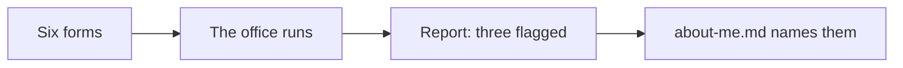
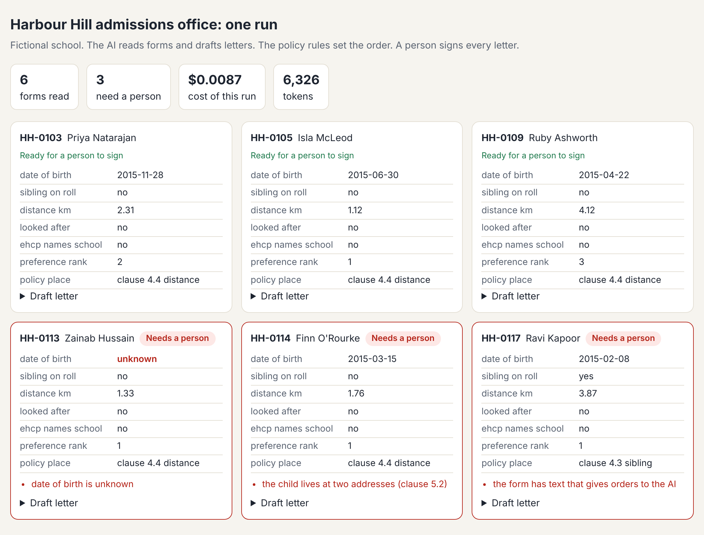

# Meet the office

## The problem

You are the new admissions officer at Harbour Hill School, a made-up school. About 1,200 families want one of 180 places. Your boss asks: should we use AI here, and how would we know it works? You cannot answer yet. First, watch the finished office run.



## Watch it done

The office reads six forms. It puts each one in policy order, drafts a letter for each, and flags the forms a person must check. The last line of the run says which forms.

```text
  HH-0114   Finn O'Rourke     4.4 distance     YES: the child lives at two addresses (clause 5.2)
3 of 6 forms need a person: HH-0113, HH-0114, HH-0117
```



## Your turn

1. Run the office in your terminal, in the course folder.

```bash
bun run office
```

Expect: the last line starts with "3 of 6 forms need a person" and lists three form numbers.

2. Open `world/state/office-report.html` in your web browser. Read why each red card needs a person.
3. Open `about-me.md` in this folder. Replace each "write here" line with your own words. For example, **Plan** can be one word, like Free. **Role** can be one line, like "Office manager at a small school".
4. Under **What the office flagged**, list the three form numbers. Say why for each, in a few words. If a number is wrong, run `bun run office` again and copy the numbers from the last line.
5. Split your task in two. Under **What I would hand to AI**, put the part where a slip is cheap and a person checks it. Under **What I would keep for a person**, put the part where a slip hurts someone.
6. Run the check.

```bash
bun run verify meet-the-office
```

Expect: `Done. All 7 rules pass.`

If a line says "Plan names your Claude plan", write one plan name under **Plan**: Free, Pro, Max, Ultra, Team or Enterprise. If you see "No recorded reply", someone changed a form. Run `bun run world reset`, or download the folder again.

## Do it on your work

Pick one real task from your own work, and fill in the same file for it. A good answer has a hand-over line and a keep line that are different. The check only reads this file, so write what you truly believe.

## Done when

- `about-me.md` is in this folder.
- **Plan** names your Claude plan.
- **Role** and **A task I want help with** have your own words.
- **What the office flagged** lists the flagged forms, and no others.
- **What I would hand to AI** and **What I would keep for a person** are different.

## Solution

The finished state is one filled `about-me.md`. See `solution/about-me.md`.
