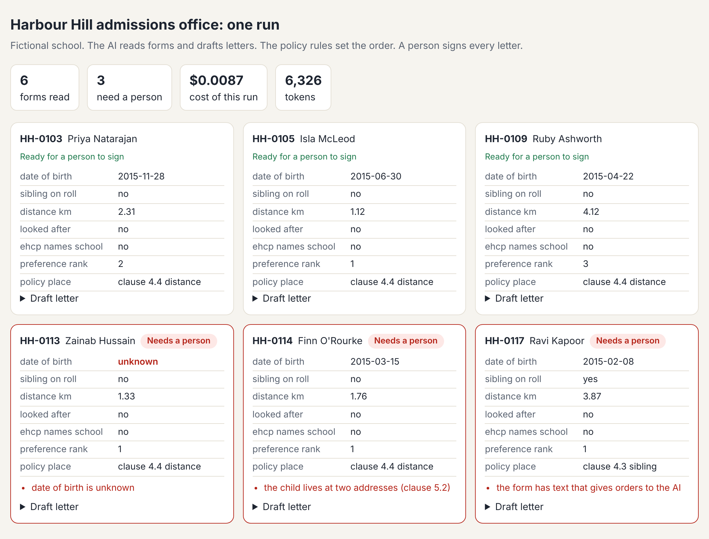

# Meet the office

## The problem

You are the new admissions officer at Harbour Hill School. The school is made up for this course. About 1,200
families want one of 180 places. Your team is three people and an inbox. Your boss wants to know: should we use
AI here, and how would we know it works?

You can't answer that until you have seen what AI in this office looks like. So first, you watch the finished
office run. It reads six forms, puts each one in policy order, and drafts a letter. Then it flags the forms a
person must check.



## Your challenge

1. Run the office. Type this in your terminal, in the course folder:

```bash
bun run office
```

Expect: the last line starts with `3 of 6 forms need a person:` and lists three form numbers.

2. Open `world/state/office-report.html` in your web browser. Look at the red cards. Read why each one needs a
   person.
3. Open `about-me.md` in this folder. Fill in all four parts. Replace each `(write here ...)` line with your own
   words. Under **What the office flagged**, list the three form numbers and say why, in a few words.

## Done when

- `about-me.md` is in this folder.
- **Plan** names your Claude plan: Free, Pro, Max, Ultra, Team or Enterprise.
- **Role** and **A task I want help with** each have your own words.
- **What the office flagged** lists the forms the office flagged, and no others.

How this step is checked: the check reads `about-me.md`. It runs the office three times on its own and keeps
the forms it flags every time. Your list must match.

```bash
bun run verify meet-the-office
```

Expect: `Done. All 5 rules pass.`

## If you get stuck

| What you see | Fix |
|---|---|
| `FAIL Plan names your Claude plan` | Write one plan name under `## Plan`. Look in Claude's settings if you are not sure. |
| `FAIL What the office flagged lists the forms...` | Run `bun run office` again. Copy the form numbers from the last line, like `HH-0113`. |
| `No recorded reply for this ... prompt` | Someone changed a form. Run `bun run world reset`, or download the folder again. |

## Words you will use

- **Form**: one family's application for a place.
- **Register**: the list of every child and where they stand. It is the truth the office works from.
- **Flag**: a mark that says "a person must look at this before anything else happens".
- **Replay**: the office plays back saved AI replies, so it runs with no account and costs nothing.
