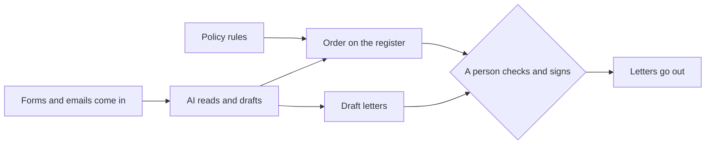

# Meet the office

## After this part you can

Run the finished office. Say which forms it flags for a person.

## You leave with

An `about-me.md` file. It names your plan, your role, one task, and the part you would hand to AI.

## The problem

Harbour Hill School is made up for this course. It is a free state school with 180 places in Year 7, the first year of secondary school. About 1,200 families apply.

Three people read every form, answer every email, keep the waiting list and sign every letter.

Schools now use AI for this kind of work. So the real question is not whether AI can read a form. The real questions are these: What should the AI do? What does it cost? Who checks its work?

For example, form HH-0113 is for Zainab Hussain. It has no date of birth. The finished office does not guess. It flags the form and says the date of birth is unknown. A flag means a person must look first.

Two words in the diagram are new. The **policy** is the school's written rules for who gets a place. The **register** is the list of every child and where they stand.



## Steps

| Step                                                    | What you hand in | What the check reads                                       |
| ------------------------------------------------------- | ---------------- | ---------------------------------------------------------- |
| [meet-the-office](01-meet-the-office/problem/README.md) | `about-me.md`    | your plan, role and task, and the forms the office flagged |

Run these three commands, one after the other.

```bash
bun run world
```

Expect: `The office is ready. Next: bun run office`

```bash
bun run office
```

Expect: the last line says "3 of 6 forms need a person" and names three forms.

```bash
bun run verify meet-the-office
```

Expect: `Done. All 7 rules pass.` once `about-me.md` is filled in.

## Watch and read

| Kind  | Title                                   | Author          | Why                                                   | Link                                                         |
| ----- | --------------------------------------- | --------------- | ----------------------------------------------------- | ------------------------------------------------------------ |
| video | Large Language Models explained briefly | 3Blue1Brown     | A short, clear picture of what an AI model does       | https://www.youtube.com/watch?v=LPZh9BOjkQs                  |
| video | Intro to Large Language Models          | Andrej Karpathy | A full talk on what these models can and cannot do    | https://www.youtube.com/watch?v=zjkBMFhNj_g                  |
| read  | Building effective agents               | Anthropic       | Why to keep the AI system simple and add steps slowly | https://www.anthropic.com/research/building-effective-agents |
| read  | Models overview                         | Anthropic       | What the Claude models are and how they differ        | https://platform.claude.com/docs/en/models/overview          |

## Project

Name one real task from your own work. Say which part you would give to AI, and which part a person keeps.
