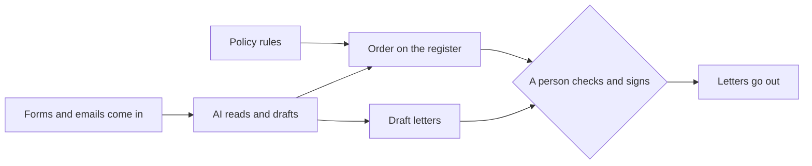

# Meet the office

## The problem

Harbour Hill School is made up for this course. It is a state school with 180 places in Year 7, and about 1,200
families apply. Three people read every form, answer every email, keep the waiting list and sign every letter.

Schools and colleges now use AI for this kind of work. The question is not "can AI read a form?" It is "what
should it do, what does it cost, and who checks it?" In this part you meet the office and watch the finished
system run, so you know where the course is going.



| Step | Minutes | What you hand in | What the check reads |
|---|---|---|---|
| [meet-the-office](01-meet-the-office/problem/README.md) | 15 | `about-me.md` | your plan, role and task, and the forms the office flagged |

## Walkthrough

```bash
bun run world
```

Expect: `The office is ready. Next: bun run office`

```bash
bun run office
```

Expect: `3 of 6 forms need a person: HH-0113, HH-0114, HH-0117`

```bash
bun run verify meet-the-office
```

Expect: `Done. All 5 rules pass.` once `about-me.md` is filled in.
