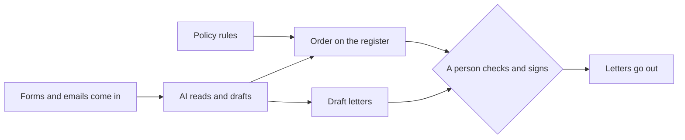

# Meet the office

## The problem

Harbour Hill School is made up for this course. It is a free state school. It has 180 places in Year 7, the
first year of secondary school. About 1,200 families apply for those places. Three people read every form and answer every email. They also keep the waiting
list and sign every letter.

Schools and colleges now use AI for this kind of work. So the question is not "can AI read a form?" The real
questions are these:

- What should the AI do?
- What does it cost?
- Who checks its work?

In this part you meet the office. You watch the finished system run, so you know where the course is going.

For example, the finished office reads form HH-0113 for Zainab Hussain. The form has no date of birth. So the
office does not guess. It flags the form, and it prints `YES: date of birth is unknown`. A flag means "a person
must look at this first".

The diagram shows the whole office. Two words in it may be new:

- The **policy** is the school's written rules for who gets a place.
- The **register** is the list of every child and where they stand.

The AI reads and drafts. The policy sets the order on the register. A person checks and signs.



In this part there is one step:

| Step                                                    | Minutes | What you hand in | What the check reads                                       |
| ------------------------------------------------------- | ------- | ---------------- | ---------------------------------------------------------- |
| [meet-the-office](01-meet-the-office/problem/README.md) | 15      | `about-me.md`    | your plan, role and task, and the forms the office flagged |

## Walkthrough

Run these three commands in order. The Expect line under each one says what you should see.

```bash
bun run world
```

Expect: `The office is ready. Next: bun run office`

```bash
bun run office
```

Expect: `3 of 6 forms need a person: HH-0113, HH-0114, HH-0117`

```bash
bun run verify meet-the-office
```

Expect: `Done. All 5 rules pass.` once `about-me.md` is filled in.
