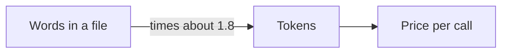
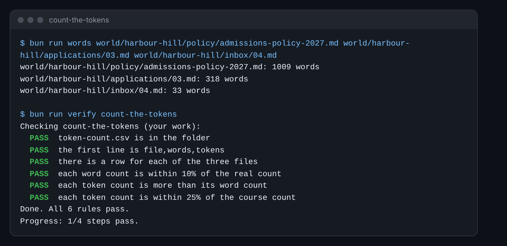

# Count the tokens

## The problem

Your boss asks: "What would AI cost us for the whole season?" AI is priced in tokens, not pages. A token is a small piece of text, often part of a word. So first count the tokens in the office's files. The policy file has 1,009 words.



## Watch it done

Before, `token-count.csv` has only its first line. After, it has a row for each file. For the policy, 1,009 words times 1.8 is 1,816 tokens.

```text
file,words,tokens
policy/admissions-policy-2027.md,1009,1816
```



## Your turn

Fill in `token-count.csv` in this folder. Use `world/harbour-hill/policy/admissions-policy-2027.md`, `applications/03.md` and `inbox/04.md`.

1. Count the words in a file.

```bash
bun run words world/harbour-hill/inbox/04.md
```

Expect: `world/harbour-hill/inbox/04.md: 33 words`

2. Turn words into tokens. Claude's docs say one million tokens is about 555,000 words. That is about 1.8 tokens for each word. Multiply the words by 1.8, and round to a whole number. For example, 32 words times 1.8 is 57.6, so write 58.
3. Put the words and tokens in each row of the CSV. A CSV is a plain table file, with commas between the columns. If your spreadsheet changes the first line, put back `file,words,tokens`.
4. Run the check.

```bash
bun run verify count-the-tokens
```

Expect: `Done. All 6 rules pass.`

If a word count fails, count again with `bun run words` and the file path. If a token count fails, you may have copied the words into the tokens column. Multiply by 1.8.

## Do it on your work

Count one real file of your own, such as a policy or a long email. A good answer is a number you can multiply by 1,200 for a season. Go further: with your own AI key, `bun run measure-tokens` asks Claude for the real count and saves it in `world/keys/tokens.json`. How close was 1.8?

## Done when

- `token-count.csv` has the first line `file,words,tokens` and a row for each of the three files.
- Each word count is within 10% of the real count.
- Each token count is more than its word count, and within 25% of the course count.

## Solution

The finished state is a filled `token-count.csv`. See `solution/token-count.csv`.
