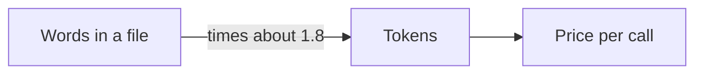
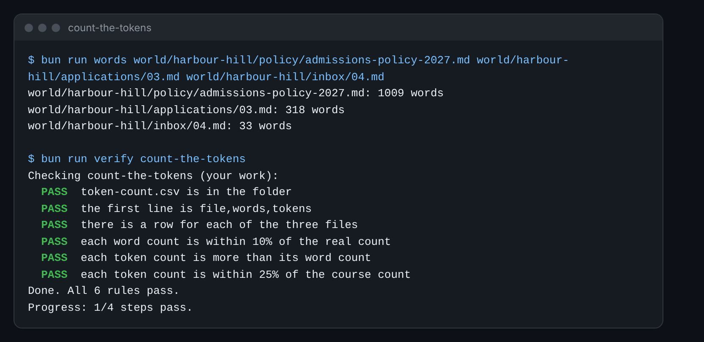

# Count the tokens

## The problem

Your boss asks a simple question: "What would AI cost us for the whole season?" You cannot answer in words or
pages, because AI is priced in **tokens**. A token is a small piece of text, often part of a word. So first you
find out how many tokens the office's files have.



## Your challenge

Fill in `token-count.csv` in this folder. It has one row for each of three files in `world/harbour-hill/`:

- `policy/admissions-policy-2027.md`
- `applications/03.md`
- `inbox/04.md`

1. Count the words in each file. Use your editor's word count, or run this in the course folder:

```bash
bun run words world/harbour-hill/inbox/04.md
```

Expect: `world/harbour-hill/inbox/04.md: 33 words`

2. Turn words into tokens. Claude's docs say one million tokens is about 555,000 words. That is about 1.8 tokens
   for each word. So multiply the words by 1.8 and round it to a whole number.
3. Open `token-count.csv` in a spreadsheet or a text editor. Put the words and tokens in each row. Save it as CSV.

For example, the email `inbox/04.md` asks how long a family has to appeal. It has 33 words. 33 times 1.8 is 59.4,
so you write 59 tokens. Its row in your file is `inbox/04.md,33,59`.



## Done when

- `token-count.csv` is in this folder, and its first line is `file,words,tokens`.
- There is a row for each of the three files.
- Each word count is within 10% of the real count.
- Each token count is more than its word count, and within 25% of the course count.

How this step is checked: the check reads your CSV. It counts the words in each file itself. Then it compares
your tokens to the count the course keeps in `world/keys/tokens.json`.

```bash
bun run verify count-the-tokens
```

Expect: `Done. All 6 rules pass.`

## If you get stuck

| What you see                                        | Fix                                                                             |
| --------------------------------------------------- | ------------------------------------------------------------------------------- |
| `FAIL the first line is file,words,tokens`          | Your spreadsheet may have changed the first line. Put back `file,words,tokens`. |
| `FAIL each word count is within 10%...`             | Count again. Run `bun run words` with the file path after it.                   |
| `FAIL each token count is more than its word count` | You may have copied the words into the tokens column. Multiply by 1.8.          |

Go further: an API key is a secret password for your own AI account. If you have one, `bun run measure-tokens`
asks Claude's token counter for the real count. How close was 1.8?

## Words you will use

- **Token**: a small piece of text, often part of a word. AI reads and writes in tokens, and you pay per token.
- **Word count**: how many words a file has. Most editors can show it.
- **CSV**: a plain table file. Each line is a row, and commas split the columns.
