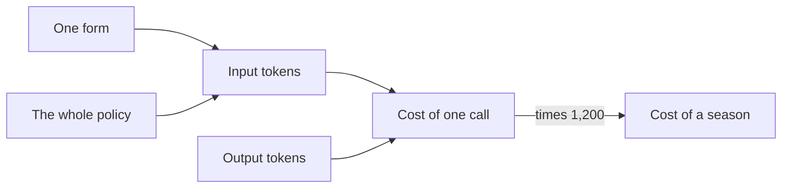
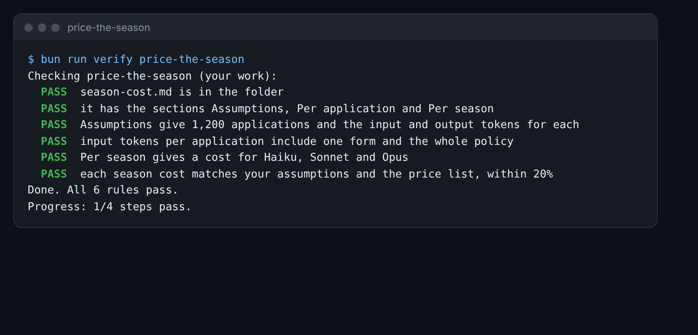

# Price the season

## The problem

Your boss wants one number: what does a season cost? A season is 1,200 forms. Each call sends the form and the whole policy, and gets one short row back. A model is the AI program. Claude has three, Haiku, Sonnet and Opus, so you price all three.



## Watch it done

Before, `season-cost.md` has empty numbers. After, each model has a season cost. With the sample numbers, Sonnet comes to about $9.33.

```text
| Haiku  | $0.47  |
| Sonnet | $9.33  |
| Opus   | $18.66 |
```



## Your turn

Fill in `season-cost.md` in this folder.

1. Under **Assumptions**, put the tokens for one form and for the policy. Use your numbers from count-the-tokens. Add them to get the input tokens for one call. Leave the output at 300, about one table row and a short note.
2. Open the [Claude pricing page](https://platform.claude.com/docs/en/about-claude/pricing). Find the input and output price for Haiku, Sonnet and Opus. For Haiku, use the price for prompts up to 100,000 tokens.
3. Work out each model. Prices are per million tokens, so divide by 1,000,000. For example, Sonnet: 2,388 input tokens at $2 per million is $0.004776. 300 output tokens at $10 per million is $0.003. One call is $0.007776. Times 1,200 is about $9.33.
4. Put a season cost like $9.33 in each row of the **Per season** table. You can ask Claude to do the sums. Check one line yourself.
5. Run the check.

```bash
bun run verify price-the-season
```

Expect: `Done. All 6 rules pass.`

If the input tokens fail, add the policy tokens to the form tokens, because every call sends both. If a season cost fails, did you divide by 1,000,000 and add the output cost?

## Do it on your work

Price one job of your own: its files, its number of cases, and a short reply. Good looks like a table with three models and one season total each, and one line you checked by hand.

## Done when

- `season-cost.md` has Assumptions, Per application and Per season.
- The input tokens include one form and the whole policy.
- Per season gives a cost for Haiku, Sonnet and Opus.
- Each season cost matches your assumptions and the price list, within 20%.

## Solution

The after state is a filled `season-cost.md`. See `solution/season-cost.md`.
