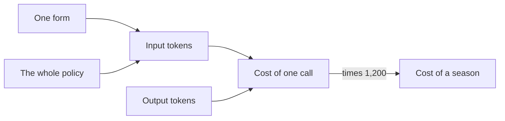
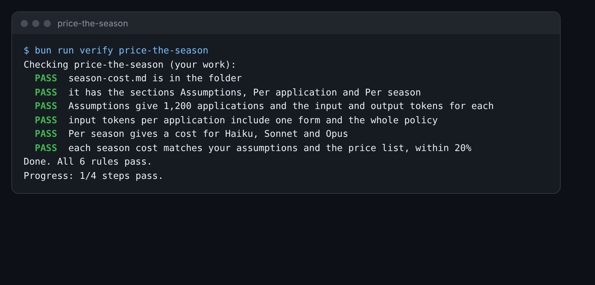

# Price the season

## The problem

Now you know how big the files are. Your boss still wants one number: what does a season cost? A season is
1,200 forms. For each form, the AI gets the form and the whole policy. It writes back one short row.

A model is the AI program that reads and writes. The Claude app has three models in its menu: Haiku, Sonnet and
Opus. They do not cost the same, so you price the season on all three.



## Your challenge

Fill in `season-cost.md` in this folder.

1. Under **Assumptions**, put the tokens for one form and for the policy. Use your numbers from count-the-tokens.
   Add them up to get the input tokens for one call. Leave the output at 300.
2. Open the Claude pricing page: https://platform.claude.com/docs/en/about-claude/pricing. Find the input and output
   price for Haiku 5.5, Sonnet 5.5 and Opus 5.5. For Haiku, use the price for prompts up to 100,000 tokens.
3. Work out each row. Prices are per million tokens, so divide by 1,000,000.
4. Multiply each one by 1,200 to get the season. You can paste your numbers into Claude and ask it to do the sums.
   Check one line yourself.

For example, here is Sonnet with the sample numbers. Form 03 is 572 tokens and the policy is 1,816 tokens. So one
call sends 2,388 input tokens and gets 300 output tokens back.

- Input: 2,388 tokens at $2 per million is $0.004776.
- Output: 300 tokens at $10 per million is $0.003.
- One call: $0.004776 plus $0.003 is $0.007776.
- One season: $0.007776 times 1,200 is about $9.33.



## Done when

- `season-cost.md` has the sections Assumptions, Per application and Per season.
- Assumptions give 1,200 forms, and the input and output tokens for each.
- The input tokens include one form and the whole policy.
- Per season gives a cost for Haiku, Sonnet and Opus.
- Each season cost matches your own assumptions and the price list, within 20%.

How this step is checked: the check reads your sheet. It takes your own token numbers. Then it works out the cost
from the price list in `config/prices.ts`. So a small slip in a sum is fine. A wrong method is not.

```bash
bun run verify price-the-season
```

Expect: `Done. All 6 rules pass.`

## If you get stuck

| What you see                                   | Fix                                                                               |
| ---------------------------------------------- | --------------------------------------------------------------------------------- |
| `FAIL input tokens per application include...` | Add the policy tokens to the form tokens. Every call sends both.                  |
| `FAIL each season cost matches...`             | Did you divide by 1,000,000? Did you add the output cost? Check one line by hand. |
| `FAIL Per season gives a cost for...`          | Put a cost like `$9.33` in each row of the Per season table.                      |

## Words you will use

- **Input tokens**: the tokens you send to the AI: the form, the policy and your question.
- **Output tokens**: the tokens the AI writes back. They cost more than input tokens.
- **Per million**: prices are for one million tokens. Divide by 1,000,000 to get the price of one token.
