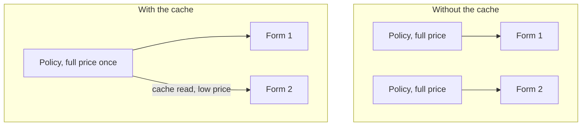
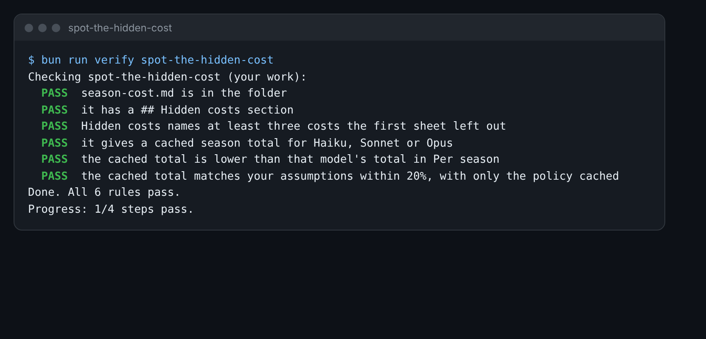

# Spot the hidden cost

## The problem

The plain sum leaves costs out. Each call sends 2,388 input tokens, and 1,816 of them are the same policy, at full price, 1,200 times. Caching fixes that. The AI keeps the start of a prompt for a short while and reads it back for much less.



## Watch it done

Before, the sheet has no Hidden costs section. After, it names the hidden costs and gives a cached total. On Sonnet, the policy part falls from about $4.36 to about $0.22.

```text
Cached season total for Sonnet: $5.19
```



## Your turn

Use the `season-cost.md` in this folder. It is a filled sheet. You can also copy in your own.

1. Under **Hidden costs**, write at least three costs the first sheet left out. Look for the policy sent every time, output tokens, retries, cache and batch. A batch is many calls sent at once, and the pricing page says it costs half. A retry is a call run again after it failed, and you pay again. Say why each one matters in a line.
2. On the pricing page, find the cache hits price for one model.
3. Work the season again. Price the policy tokens at the cache price. Keep the form and the reply at full price. For example, Sonnet reads the policy from the cache at $0.10 per million, not $2.
4. Write one line with your model and your number.

```text
Cached season total for Sonnet: $0.00
```

5. Run the check.

```bash
bun run verify spot-the-hidden-cost
```

Expect: `Done. All 6 rules pass.`

If the cached total fails, only the policy is cached. The form changes each time, so it stays at full price. The cache lasts only a short while, so it saves money when forms run close together.

## Do it on your work

List the hidden costs for your own job, the same way. Good looks like three named costs and one cached total that is lower than the plain one.

## Done when

- `season-cost.md` has a Hidden costs section that names at least three costs.
- It gives a cached season total for Haiku, Sonnet or Opus.
- That total is lower than the same model's total in Per season, and matches your numbers within 20%.

## Solution

The after state is a sheet with Hidden costs and a cached total. See `solution/season-cost.md`.
