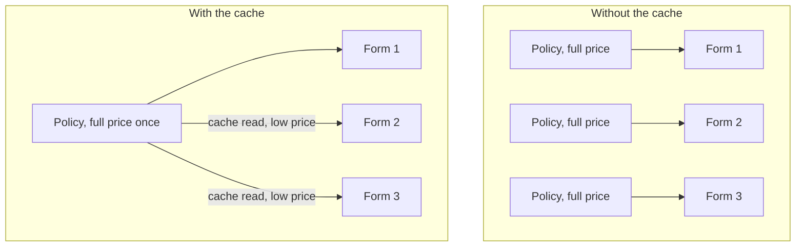
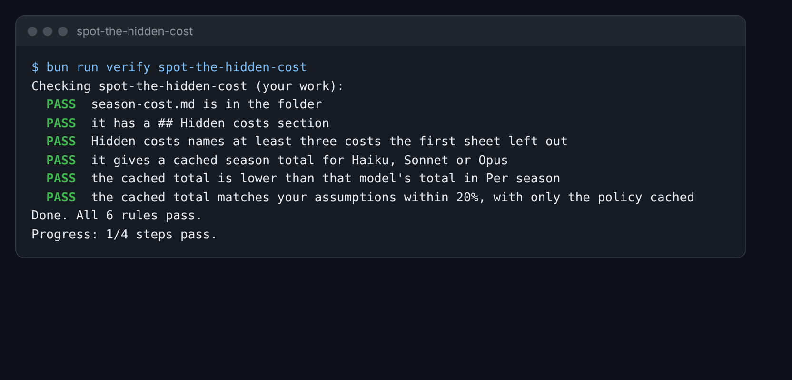

# Spot the hidden cost

## The problem

Your sheet says what the plain sum costs. Real bills are not that simple. Some costs hide, and some costs can be
cut. Look at your sheet: most of each call is the policy, and it is the same text 1,200 times. You pay for it
1,200 times.

**Caching** fixes that. The AI keeps the same first part of a prompt for a short while. When the next call starts
with the same text, it reads it from the cache at a much lower price.



## Your challenge

The `season-cost.md` in this folder is a filled sheet. You can use it, or copy in your own from price-the-season.

1. Under **Hidden costs**, write at least three costs the first sheet left out. Look for: the policy sent every
   time, output tokens, retries, caching and batch. Say why each one matters, in a line or two.
2. Pick one model. On the pricing page, find its **cache hits** price.
3. Work out the season again. Price the policy tokens at the cache price. Keep the form and the reply at full price.
   Write it as: `Cached season total for Sonnet: $0.00`, with your model and your number.



## Done when

- `season-cost.md` has a `## Hidden costs` section.
- It names at least three costs the first sheet left out.
- It gives a cached season total for Haiku, Sonnet or Opus.
- That total is lower than the same model's total in Per season.
- It matches your own assumptions within 20%, with only the policy cached.

How this step is checked: the check reads your sheet. It looks for the hidden costs by name. Then it works out the
cached total from your own numbers and the price list.

```bash
bun run verify spot-the-hidden-cost
```

Expect: `Done. All 6 rules pass.`

## If you get stuck

| What you see | Fix |
|---|---|
| `FAIL it gives a cached season total...` | Write the line just like this: `Cached season total for Sonnet: $5.00`. |
| `FAIL the cached total matches...` | Only the policy is cached. The form changes each time, so it stays at full price. |
| `FAIL Hidden costs names at least three...` | Use the words policy, output, retry, cache or batch in your lines. |

## Words you will use

- **Cache**: a short memory of the start of a prompt. Reading from it costs much less than sending it fresh.
- **Batch**: sending many calls at once and waiting for the answers. Claude's docs say it costs half.
- **Retry**: running a call again after it failed. You pay again.
