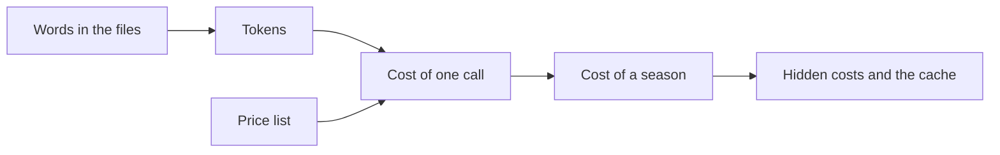

# Price the work

## After this part you can

Price a season of AI work in dollars, and name the costs that hide in the bill.

## You leave with

A `season-cost.md` sheet with a season cost for three models, a list of hidden costs, and a cached total.

## The problem

Before your boss says yes to AI, they want a number. Most people guess, and a guess can be very wrong. AI is not priced by the page. It is priced by the token, and some costs hide. A **token** is a small piece of text, often part of a word. You pay for every token you send and every token the AI writes back.

For example, the school's policy file has 1,009 words, about 1,816 tokens. Every form goes to the AI with the whole policy, so you pay for those tokens 1,200 times. On Sonnet, one of Claude's three models, the sample answer works out a season at $9.33.

Cost is a real reason teams pick AI or drop it. Newfront, an insurance company, says it got "60% cost savings in document processing" ([Newfront's story on claude.com](https://claude.com/customers/newfront)). That claim only means something if you can price the work yourself.



## Steps

| Step                                                              | What you hand in                   | What the check reads                                                                       |
| ----------------------------------------------------------------- | ---------------------------------- | ------------------------------------------------------------------------------------------ |
| [count-the-tokens](01-count-the-tokens/problem/README.md)         | `token-count.csv`                  | words and tokens for three files, against the course count                                 |
| [price-the-season](02-price-the-season/problem/README.md)         | `season-cost.md`                   | your assumptions, and a season cost for three models, worked out again from the price list |
| [spot-the-hidden-cost](03-spot-the-hidden-cost/problem/README.md) | `season-cost.md` with Hidden costs | three hidden costs by name, and a cached season total                                      |

Prices come from the [Claude pricing page](https://platform.claude.com/docs/en/about-claude/pricing). The course keeps a copy in `config/prices.ts`.

```bash
bun run words world/harbour-hill/policy/admissions-policy-2027.md
```

Expect: `world/harbour-hill/policy/admissions-policy-2027.md: 1009 words`

```bash
bun run verify count-the-tokens
```

Expect: `Done. All 6 rules pass.` once `token-count.csv` is filled in.

```bash
bun run verify price-the-season
```

Expect: `Done. All 6 rules pass.` once `season-cost.md` is filled in.

```bash
bun run verify spot-the-hidden-cost
```

Expect: `Done. All 6 rules pass.` once Hidden costs is filled in.

```bash
bun run verify part price-the-work
```

Expect: `Part price-the-work is done: 3/3 steps pass.`

## Watch and read

| Kind  | Title                          | Author          | Why                                                 | Link                                                                 |
| ----- | ------------------------------ | --------------- | --------------------------------------------------- | -------------------------------------------------------------------- |
| video | Let's build the GPT Tokenizer  | Andrej Karpathy | Shows how text is cut into tokens, and why it costs | https://www.youtube.com/watch?v=zduSFxRajkE                          |
| video | Intro to Large Language Models | Andrej Karpathy | Context for why input and output are priced apart   | https://www.youtube.com/watch?v=zjkBMFhNj_g                          |
| read  | Pricing                        | Anthropic       | The price list the course copies                    | https://platform.claude.com/docs/en/about-claude/pricing             |
| read  | Prompt caching                 | Anthropic       | How a cache read costs less than fresh input        | https://platform.claude.com/docs/en/build-with-claude/prompt-caching |
| read  | Token counting                 | Anthropic       | How to count tokens before you pay for them         | https://platform.claude.com/docs/en/build-with-claude/token-counting |

## Project

Price one real job of your own: count its tokens, work out a season for three models, and list its hidden costs.
