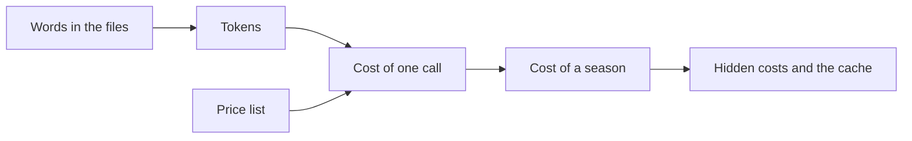

# Price the work

## The problem

Before your boss says yes to AI, they want a number: what will a whole season cost? Most people guess. A guess can
be wrong by a lot, because AI is priced in tokens, not pages, and some costs hide.

Cost is a real reason teams pick AI, or drop it. Newfront, an insurance company, says it got "60% cost savings in
document processing" ([Newfront's story on claude.com](https://claude.com/customers/newfront)). That kind of claim
only means something if you can price the work yourself. In this part you do.



| Step | Minutes | What you hand in | What the check reads |
|---|---|---|---|
| [count-the-tokens](01-count-the-tokens/problem/README.md) | 10 | `token-count.csv` | words and tokens for three files, against the course count |
| [price-the-season](02-price-the-season/problem/README.md) | 10 | `season-cost.md` | your assumptions, and a season cost for three models, worked out again from the price list |
| [spot-the-hidden-cost](03-spot-the-hidden-cost/problem/README.md) | 10 | `season-cost.md` with Hidden costs | three hidden costs by name, and a cached season total |

Prices come from the [Claude pricing page](https://platform.claude.com/docs/en/about-claude/pricing). The course
keeps a copy in `config/prices.ts`, with the date it was read.

## Walkthrough

```bash
bun run words world/harbour-hill/policy/admissions-policy-2027.md
```

Expect: `world/harbour-hill/policy/admissions-policy-2027.md: 1009 words`

```bash
bun run verify count-the-tokens
```

Expect: `Done. All 6 rules pass.` once `token-count.csv` is filled in.

```bash
bun run verify price-the-season
```

Expect: `Done. All 6 rules pass.` once `season-cost.md` is filled in.

```bash
bun run verify spot-the-hidden-cost
```

Expect: `Done. All 6 rules pass.` once Hidden costs is filled in.

```bash
bun run verify part price-the-work
```

Expect: `Part price-the-work is done: 3/3 steps pass.`
