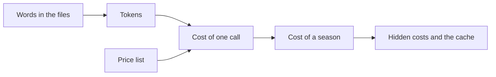

# Price the work

## The problem

Before your boss says yes to AI, they want a number. What will a whole season cost? Most people guess, and a guess
can be very wrong. AI is not priced by the page. It is priced by the token, and some costs hide.

A **token** is a small piece of text, often part of a word. The AI reads and writes in tokens. You pay for every
token you send and every token it writes back.

For example, the school's policy file has 1,009 words. That is about 1,816 tokens. Every form goes to the AI with
the whole policy, so you pay for those 1,816 tokens 1,200 times. A model is the AI program itself, and Claude has
three: Haiku, Sonnet and Opus. On Sonnet, the sample answer for this part works out a season at $9.33.

Cost is a real reason teams pick AI, or drop it. Newfront, an insurance company, says it got "60% cost savings in
document processing" ([Newfront's story on claude.com](https://claude.com/customers/newfront)). That kind of claim
only means something if you can price the work yourself. In this part, you do.

The diagram shows the path from words to the cost of a season.



This part has three steps:

| Step                                                              | Minutes | What you hand in                   | What the check reads                                                                       |
| ----------------------------------------------------------------- | ------- | ---------------------------------- | ------------------------------------------------------------------------------------------ |
| [count-the-tokens](01-count-the-tokens/problem/README.md)         | 10      | `token-count.csv`                  | words and tokens for three files, against the course count                                 |
| [price-the-season](02-price-the-season/problem/README.md)         | 10      | `season-cost.md`                   | your assumptions, and a season cost for three models, worked out again from the price list |
| [spot-the-hidden-cost](03-spot-the-hidden-cost/problem/README.md) | 10      | `season-cost.md` with Hidden costs | three hidden costs by name, and a cached season total                                      |

Prices come from the [Claude pricing page](https://platform.claude.com/docs/en/about-claude/pricing). The course
keeps a copy in `config/prices.ts`, with the date it was read.

## Walkthrough

The first command counts the words in the policy. The other commands check each step. The Expect line under each
one says what you should see.

```bash
bun run words world/harbour-hill/policy/admissions-policy-2027.md
```

Expect: `world/harbour-hill/policy/admissions-policy-2027.md: 1009 words`

```bash
bun run verify count-the-tokens
```

Expect: `Done. All 6 rules pass.` once `token-count.csv` is filled in.

```bash
bun run verify price-the-season
```

Expect: `Done. All 6 rules pass.` once `season-cost.md` is filled in.

```bash
bun run verify spot-the-hidden-cost
```

Expect: `Done. All 6 rules pass.` once Hidden costs is filled in.

```bash
bun run verify part price-the-work
```

Expect: `Part price-the-work is done: 3/3 steps pass.`
