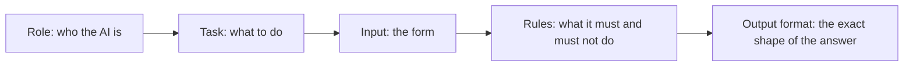
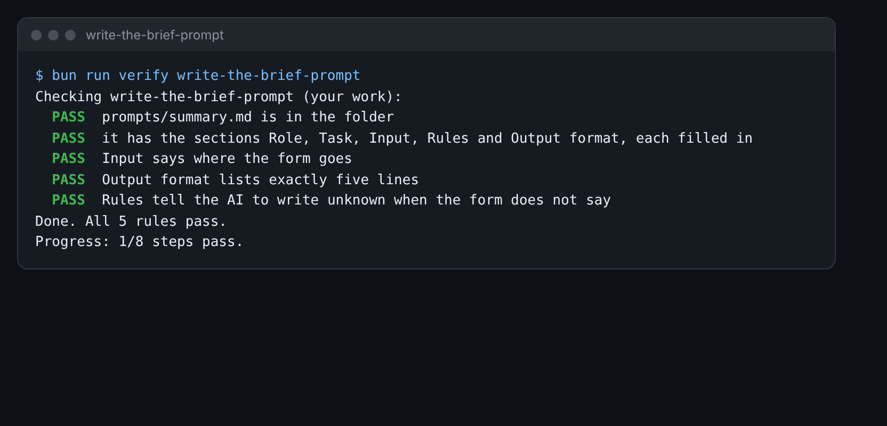

# Write the brief prompt

## The problem

The head teacher wants a short note on each form. You ask Claude: "Sum up this form." You get a nice paragraph.
But each paragraph has a new shape. One leaves out the distance. One makes up a date of birth.

The fix is a better prompt. A prompt is the text you give the AI. A good prompt has five parts:



## Your challenge

Fill in `prompts/summary.md` in this folder. It has the five headings already.

1. **Role**: say who the AI works for.
2. **Task**: ask for a summary of one form in five lines.
3. **Input**: say where the form goes.
4. **Rules**: one rule on each line. One rule must say: if the form does not say, write `unknown`.
5. **Output format**: list the five lines, one list line each. For example: the child, the home, any priority,
   the school's place in the family's list, and if a person must check it.

Then try it. Open Claude.ai. Paste your prompt, and paste `world/harbour-hill/applications/13.md` where the
form goes. Read the reply.

For example, form 13 is for Zainab Hussain. Her form has no date of birth. A good prompt gets this first line
back:

```text
1. Child: Zainab Hussain, date of birth unknown
```

A weak prompt gets a made-up date. If you see one, make your rule stronger and try again.



## Done when

- `prompts/summary.md` has the sections Role, Task, Input, Rules and Output format.
- Each section has at least one real line.
- Input says where the form goes.
- Output format lists exactly five lines.
- Rules tell the AI to write `unknown` when the form does not say.

How this step is checked: the check reads your prompt file. It does not read the chat, so the reply you got is
for you.

```bash
bun run verify write-the-brief-prompt
```

Expect: `Done. All 5 rules pass.`

## If you get stuck

| What you see                                   | Fix                                                                 |
| ---------------------------------------------- | ------------------------------------------------------------------- |
| `FAIL  it has the sections Role, Task...`      | Keep the five `##` headings. Write a line under each one.           |
| `FAIL  Output format lists exactly five lines` | Start each summary line with `1.` or `-`. Use five lines, no more.  |
| `FAIL  Rules tell the AI to write unknown...`  | Add the rule: If the form does not say, write unknown. Never guess. |

## Words you will use

- **Prompt**: the text you give the AI. It says what to do and how to answer.
- **Role**: who the AI should act as, such as a helper in the admissions office.
- **Output format**: the exact shape you want back, such as five lines with fixed names.
- **Unknown**: the word the AI writes when the form does not give the fact.
