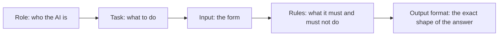
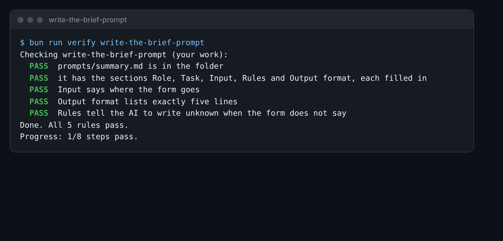

# Write the brief prompt

## The problem

The head teacher wants a short note on each form. You ask Claude: "Sum up this form." Each reply has a new shape. One leaves out the distance. One makes up a date of birth.

The fix is a better prompt, the text you give the AI.



## Watch it done

Before, a vague prompt makes up a date for form 13. After, a prompt with a rule about unknown gives this first line.

```text
1. Child: Zainab Hussain, date of birth unknown
```



## Your turn

Fill in `prompts/summary.md` in this folder. It has five headings already.

1. Under **Role**, say who the AI works for.
2. Under **Task**, ask for a summary of one form in five lines.
3. Under **Input**, say where the form goes.
4. Under **Rules**, write one rule on each line. One rule must say: if the form does not say, write unknown. Never guess.
5. Under **Output format**, list the five lines, one list line each. For example: the child, the home, any priority, the school's place in the family's list, and if a person must check it.
6. Try it. Open Claude.ai.

   Paste your prompt, and paste `world/harbour-hill/applications/13.md` where the form goes. Read the reply. A made-up date means your rule is too weak. Make it stronger and try again.
7. Try a second form. After each try, add a row to **What I changed after trying it**: what went wrong, and the one thing you changed. A prompt gets good by small fixes.
8. Run the check.

```bash
bun run verify write-the-brief-prompt
```

Expect: `Done. All 6 rules pass.`

If a line says the output must have five lines, start each summary line with `1.` or `-`. If the unknown rule fails, add: If the form does not say, write unknown. Never guess.

## Do it on your work

Write the same five parts for one task of your own, such as a note on an email or a ticket. Good looks like a rule for every gap you fear, and a reply you can read in a few seconds.

## Done when

- `prompts/summary.md` has Role, Task, Input, Rules and Output format, each with a real line.
- Input says where the form goes.
- Output format lists exactly five lines.
- Rules tell the AI to write unknown when the form does not say.
- **What I changed after trying it** has two tries.

## Solution

The after state is a filled prompt file. See `solution/prompts/summary.md`.
