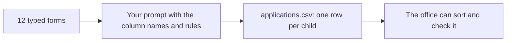
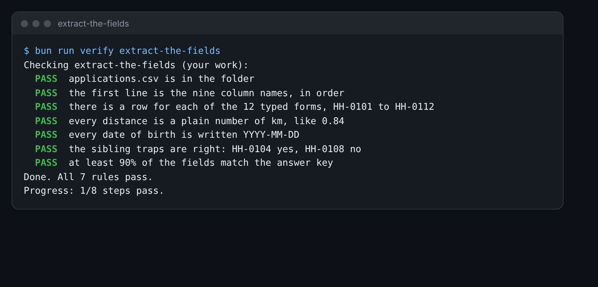

# Extract the fields

## The problem

The office ranks children by the rules in the policy. To do that, it needs the same facts from every form, in
the same place. A pile of forms is not a list you can sort. A table is.

You have 12 typed forms, `applications/01.md` to `12.md`. You turn them into one table with one row for each
child.



## Your challenge

Fill in `applications.csv` in this folder. The first line has the nine column names. The second line is a worked
row for form 01. Keep both.

Here is what each column holds:

- `application_id`: the form number, like `HH-0101`. Form `01.md` is `HH-0101`.
- `child_name` and `date_of_birth`: the child's full name and birthday.
- `sibling_on_roll`: `yes` if a brother or sister is at the school now.
- `distance_km`: how far the home is from the school gate.
- `looked_after`: `yes` if the child is in the care of the council.
- `ehcp_names_school`: `yes` if the child's EHCP names Harbour Hill.
- `preference_rank`: where Harbour Hill is in the family's list. `1` means first choice.
- `needs_person`: `yes` if a person must check this form.

1. Open Claude.ai. Start a new chat.
2. Write a prompt that asks for one CSV row per form. Paste the first line of the starter, so Claude uses the
   same columns in the same order.
3. Add these rules to your prompt:
   - Dates as YYYY-MM-DD.
   - Distance as a plain number of km, with no units.
   - `yes` or `no` for the yes and no columns.
   - `needs_person` is `yes` when a fact is missing or unclear. Otherwise `no`.
   - If the form does not say, write `unknown`. Never guess.
4. Paste forms 02 to 12. Ask Claude to make a CSV file you can download.
5. Copy the rows into `applications.csv`, under the worked row.

Read the sibling column with care. Clause 4.3 of the 2027 policy says who counts as a sibling.

For example, form 08 is for Kofi Mensah. His sister goes to Harbour Hill Primary, not to the secondary school.
So she does not count. His row says `no` in `sibling_on_roll`:

```text
HH-0108,Kofi Mensah,2015-10-11,no,1.98,no,no,1,no
```

Form 04 is for Tomasz Nowak. His stepsister is in Year 9 and lives with him. Under the 2027 policy she counts,
so his row says `yes`.



## Done when

- `applications.csv` starts with the nine column names, in order.
- It has a row for each form from HH-0101 to HH-0112.
- Every distance is a plain number, like `0.84`.
- Every date of birth is written YYYY-MM-DD.
- HH-0104 says `yes` and HH-0108 says `no` in `sibling_on_roll`.
- At least 90% of the fields match the answer key.

How this step is checked: the check compares your table with the answer key, field by field. A few slips are
fine. A wrong format is not.

```bash
bun run verify extract-the-fields
```

Expect: `Done. All 7 rules pass.`

## If you get stuck

| What you see                                      | Fix                                                                     |
| ------------------------------------------------- | ----------------------------------------------------------------------- |
| `FAIL  every distance is a plain number of km...` | Take out the letters km. Write `0.84`.                                  |
| `FAIL  every date of birth is written YYYY-MM-DD` | The forms write `02/03/2015`. Write `2015-03-02`.                       |
| `FAIL  the sibling traps are right...`            | Read clause 4.3. A stepsister counts. A sister at the primary does not. |
| `FAIL  at least 90% of the fields match...`       | Check each column against its form. Look for a column out of place.     |

## Words you will use

- **CSV**: a plain text table. Each line is a row. Commas split the columns.
- **Field**: one fact in a row, such as the date of birth.
- **Column names**: the first line of the CSV. They say what each field holds.
- **Extract**: pull the facts you need out of a longer text.
