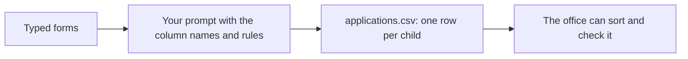
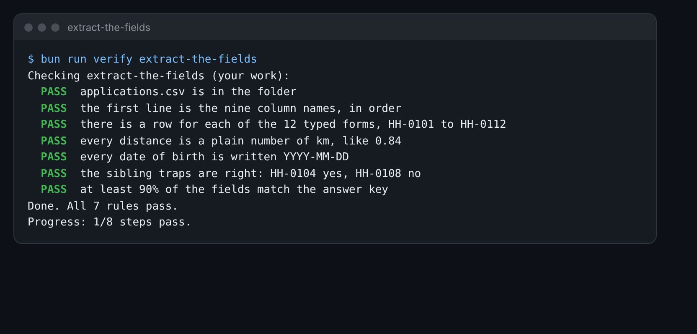

# Extract the fields

## The problem

The office ranks children by the policy. It needs the same facts from every form, in the same place. A pile of 12 typed forms cannot be sorted. A table with one row for each child can. For example, form 08 gives one row. You get the table by writing one prompt.



## Watch it done

Before, `applications.csv` has the column names and one worked row. After, it has a row for each form. Form 08 is for Kofi Mensah. His sister is at the primary school, so she does not count.

```text
HH-0108,Kofi Mensah,2015-10-11,no,1.98,no,no,1,no
```



## Your turn

Fill in `applications.csv` in this folder. Keep the first line and the worked row for form 01.

1. Open Claude.ai and start a new chat.
2. Write a prompt that asks for one CSV row per form. A CSV is a plain text table. Paste the first line of the starter so Claude uses the same columns.
3. Add these rules. Dates as YYYY-MM-DD. Distance as a plain number of km, with no units. `yes` or `no` for the yes and no columns. If the form does not say, write unknown. Never guess. A column called `needs_person` is yes when a fact is missing or unclear.
4. Paste form 04 and form 08. Four columns may be new. `sibling_on_roll` means a brother or sister is at the school now. `looked_after` means the child is in the care of the council. `ehcp_names_school` means the child's care plan names Harbour Hill. `preference_rank` is the school's place in the family's list, and 1 is first.
5. Copy the two rows into `applications.csv`. Form 04 is for Tomasz Nowak. His stepsister is in Year 9 and lives with him. Under the new policy she counts, so his row says yes.
6. Run the check.

```bash
bun run verify extract-the-fields
```

Expect: `Done. All 7 rules pass.` once all 12 forms are in.

If a distance fails, take out the letters km and write `0.84`. If a date fails, write 2015-03-02, not 02/03/2015. If the sibling rule fails, read clause 4.3. A stepsister counts. A sister at the primary does not.

## Do it on your work

Turn a pile of your own notes, forms or emails into one table. Good looks like the same columns for every row, and unknown in every gap. Go further: the check reads all 12 typed forms, so paste forms 02 to 12 the same way and copy every row under the worked row.

## Done when

- `applications.csv` starts with the nine column names, in order.
- It has a row for each form from HH-0101 to HH-0112.
- Every distance is a plain number and every date is YYYY-MM-DD.
- HH-0104 says yes and HH-0108 says no in `sibling_on_roll`.
- At least 90% of the fields match the answer key.

## Solution

The after state is a table of 12 rows. See `solution/applications.csv`.
