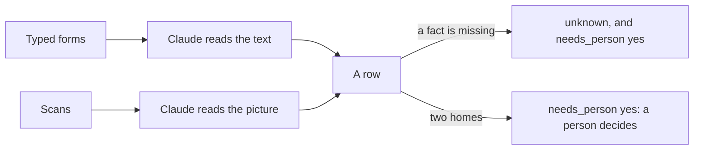
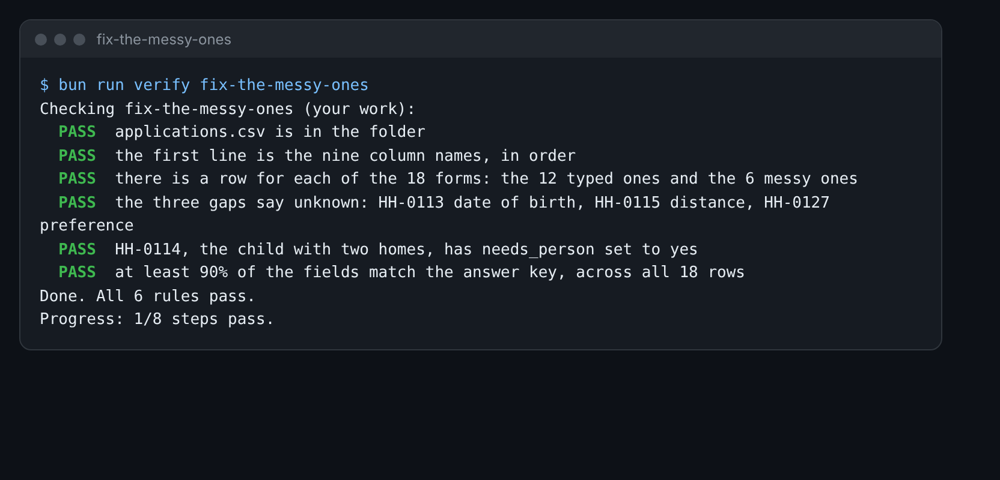

# Fix the messy ones

## The problem

Not every form is neat. Some are scans, which are photos of a paper form. Some leave a box empty. This is where AI most often guesses. A guessed date looks real, so nobody checks it.

For example, form 15 says the distance is "not sure". The row must say unknown.



## Watch it done

Before, the table has 12 rows. After, it has 18, and the gaps say unknown. Form 15 is for Maya Desai.

```text
HH-0115,Maya Desai,2015-07-07,no,unknown,no,no,1,yes
```



## Your turn

`applications.csv` in this folder has 12 rows from extract-the-fields. Add rows for forms 14 and 15.

1. Open Claude.ai. Use your prompt from the last step, with its rule about unknown.
2. Paste `applications/14.md` and `applications/15.md` from `world/harbour-hill/`. Ask for one CSV row for each.
3. Read each row next to its form. Fix any guess by hand.

   Form 14 is for Finn O'Rourke. He spends half the time at each of two homes. Under clause 5.2, a person decides when the time is equal. So his `needs_person` is yes, even though no fact is missing.
4. Add the rows to the end of `applications.csv`.
5. Run the check.

```bash
bun run verify fix-the-messy-ones
```

Expect: `Done. All 6 rules pass.` once all 18 rows are in.

If a row is missing, start each row with its HH number. If a gap fails, look at the form again. If the box is empty or smudged, write unknown.

## Do it on your work

Run your own prompt on the messiest item you have, such as a blurry photo or a half-empty form. A good answer has unknown in each gap, and a mark for a person to check.

Go further. Add form 13, and the scans 25.png, 26.png and 27.png. Attach each scan with the paperclip button. Claude can read the text in a picture. The check needs all 18 rows.

## Done when

- `applications.csv` has a row for all 18 forms: 12 typed and 6 messy.
- HH-0113 date of birth, HH-0115 distance and HH-0127 preference say unknown.
- HH-0114 has `needs_person` set to yes.
- At least 90% of the fields match the answer key.

## Solution

The finished state is a table of 18 rows. See `solution/applications.csv`.
