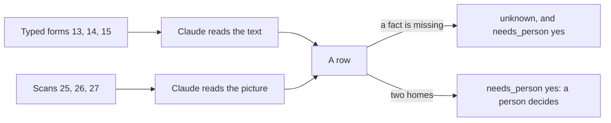
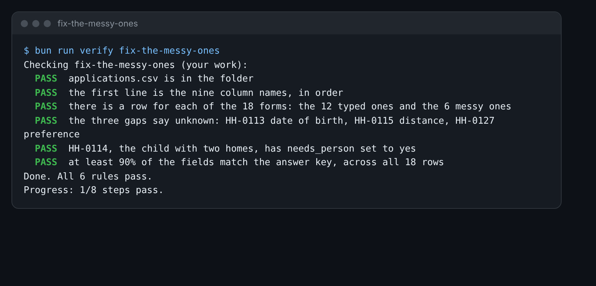

# Fix the messy ones

## The problem

Not every form is neat. Some are scans: photos of a paper form. Some leave a box empty. Some are hard to read.
This is where an AI is most likely to guess. A guessed date of birth looks real, so nobody checks it.

You add six messy forms to your table. Three of them leave one fact out. One child has two homes.



## Your challenge

`applications.csv` in this folder has the 12 rows from extract-the-fields. Add six rows:

- the typed forms `applications/13.md`, `14.md` and `15.md`;
- the scans `applications/25.png`, `26.png` and `27.png`.

1. Open Claude.ai. Use the prompt from the last step, with its rule about `unknown`.
2. Paste the three typed forms.
3. Add the three scans with the paperclip button. Claude can read text in a picture.
4. Ask for one CSV row per form. Copy the six rows to the end of `applications.csv`.
5. Read each new row next to its form. Fix any guess by hand.

For example, form 15 is for Maya Desai. The distance box says: "not sure, we could not get the map to work". So
her row says `unknown` for the distance, and `yes` for `needs_person`:

```text
HH-0115,Maya Desai,2015-07-07,no,unknown,no,no,1,yes
```

Form 14 is for Finn O'Rourke. He spends half the time at each of two homes. Clause 5.2 says that if the time is
equal, a person decides. So his row says `yes` in `needs_person`, even though no fact is missing.



## Done when

- `applications.csv` has a row for all 18 forms: 12 typed and 6 messy.
- HH-0113 date of birth, HH-0115 distance and HH-0127 preference say `unknown`.
- HH-0114 has `needs_person` set to `yes`.
- At least 90% of the fields match the answer key, across all 18 rows.

How this step is checked: the check finds the three gaps and the child with two homes. A guess in a gap fails,
even if it looks like a real date.

```bash
bun run verify fix-the-messy-ones
```

Expect: `Done. All 6 rules pass.`

## If you get stuck

| What you see                                       | Fix                                                                        |
| -------------------------------------------------- | -------------------------------------------------------------------------- |
| `FAIL  there is a row for each of the 18 forms...` | Add rows for 13, 14, 15, 25, 26 and 27. Start each with its HH number.     |
| `FAIL  the three gaps say unknown...`              | Look at the form again. If the box is empty or smudged, write unknown.     |
| `FAIL  HH-0114, the child with two homes...`       | Set `needs_person` to `yes` for HH-0114. Clause 5.2 says a person decides. |

## Words you will use

- **Scan**: a picture of a paper form. Claude can read the text in it.
- **Gap**: a fact the form does not give, or that you cannot read.
- **needs_person**: a column that says a person must look at this form before anyone acts on it.
