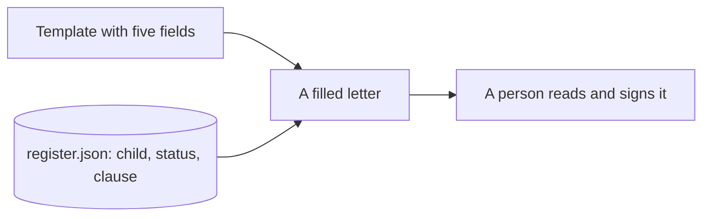
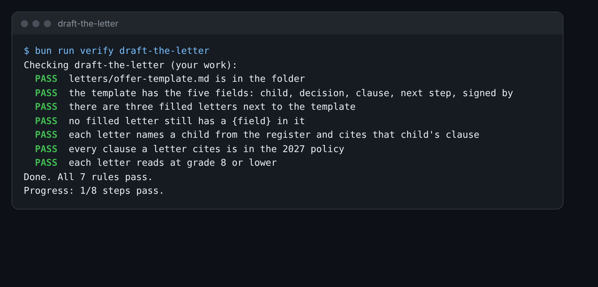

# Draft the letter

This step is extra. Do it if you have time, or come back to it later.

## The problem

Every family gets a letter, and it must cite the right clause. A wrong clause can start an appeal. For example, clause 4.6 does not exist. So build a template first: a letter with gaps, called fields. Each field is filled from the register, the list of every child.



## Watch it done

Before, the template is empty. After, it has five fields, and each letter has real words. The register says HH-0101 is Amara Okafor, offered, clause 4.4.

```text
We are happy to offer Amara a place in Year 7.
We made this choice under clause 4.4 of our admissions policy.
```



## Your turn

1. Open `letters/offer-template.md` in this folder. Write a short letter to a parent with five fields, curly brackets included: `{child}`, `{decision}`, `{clause}`, `{next step}` and `{signed by}`.
2. Pick three children from `world/harbour-hill/register.json`. Try one who is offered and one who is waitlisted.
3. Ask Claude to fill the template for each child. Paste the template and the child's row. Ask for short sentences and plain words.
4. Save each letter in the `letters` folder, named by the child, such as `HH-0101.md`.
5. Check each clause in `world/harbour-hill/policy/admissions-policy-2027.md`. AI often cites a clause that sounds right but does not exist, such as clause 4.6. Fix it by hand.
6. Run the check.

```bash
bun run verify draft-the-letter
```

Expect: `Done. All 7 rules pass.`

If a field is left, search each letter for a curly bracket, and put real words there. If a name fails, use the child's full name and the clause from the register.

## Do it on your work

Build a template for one letter you send often. A good answer has fields for every fact that changes, and a person who reads every letter before it goes.

## Done when

- `letters/offer-template.md` has the five fields.
- Three filled letters sit next to it, with no field left in curly brackets.
- Each letter names a child from the register and cites that child's clause.
- Every clause a letter cites is in the policy.
- Each letter reads at grade 8 or lower, about the level of a 13-year-old.

## Solution

The finished state is a template and three letters. See `solution/letters/`.
