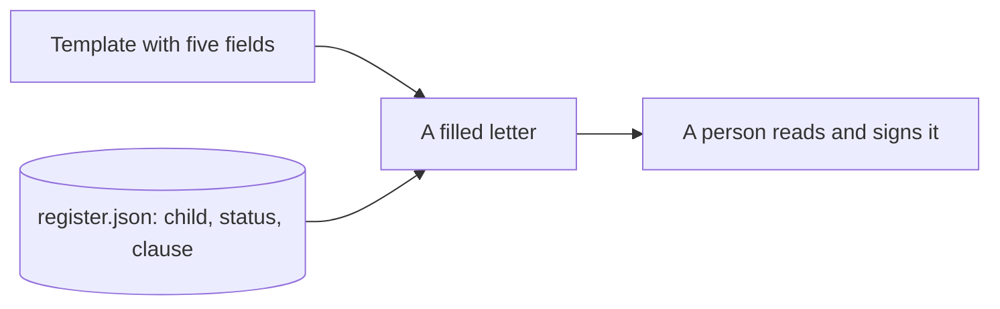
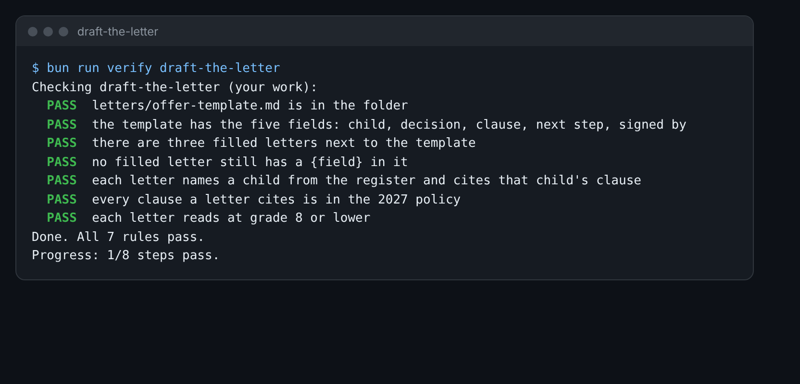

# Draft the letter

This step is extra. Do it if you have time, or come back to it later.

## The problem

Every family gets a letter. The letter must name the right child, give the right reason, and cite the right
clause. It must use words a parent can read with ease. Many parents read English as a second language.

An AI can draft 1,200 letters fast. But one wrong clause can start an appeal. So you build a template first. A
template is a letter with gaps, called fields. Each field is filled from the register, the office's list of
every child and where they stand.



## Your challenge

1. Open `letters/offer-template.md` in this folder. Write a short letter to a parent. Use these five fields, with
   their curly brackets: `{child}`, `{decision}`, `{clause}`, `{next step}` and `{signed by}`.
2. Pick three children from `world/harbour-hill/register.json`. Try to pick one who is `offered` and one who is
   `waitlisted`.
3. Ask Claude to fill in the template for each child. Paste the template and the child's row from the register.
   Ask for short sentences and plain words.
4. Save each letter in the `letters` folder, next to the template. Name it by the child, such as `HH-0101.md`.
5. Read each letter. Check the clause in `policy/admissions-policy-2027.md`. Fix it by hand if it is wrong.

For example, the register row for HH-0101 says Amara Okafor, `offered`, clause `4.4`. So her letter says:

```text
We are happy to offer Amara a place in Year 7.
We made this choice under clause 4.4 of our admissions policy.
```

Watch for one mistake AI makes often. It cites a clause that sounds right but does not exist, such as clause
4.6. The 2027 policy has no clause 4.6.



## Done when

- `letters/offer-template.md` has the five fields.
- Three filled letters sit next to it.
- No filled letter still has a field in curly brackets.
- Each letter names a child from the register and cites that child's clause, as `clause 4.4`.
- Every clause a letter cites is in the 2027 policy.
- Each letter reads at grade 8 or lower. Grade 8 is about the reading level of a 13-year-old.

How this step is checked: the check looks up each child in the register. It checks every clause number against
the policy. It scores each letter with the same reading test this course uses for its own pages.

```bash
bun run verify draft-the-letter
```

Expect: `Done. All 7 rules pass.`

## If you get stuck

| What you see                                           | Fix                                                                  |
| ------------------------------------------------------ | -------------------------------------------------------------------- |
| `FAIL  no filled letter still has a {field} in it`     | Search each letter for `{`. Put real words in its place.             |
| `FAIL  each letter names a child from the register...` | Use the child's full name, and the clause from the register.         |
| `FAIL  every clause a letter cites is in the 2027...`  | Find each clause number in the policy. Remove any that is not there. |

## Words you will use

- **Template**: a letter with gaps you fill in for each person.
- **Field**: one gap in the template, such as `{child}`.
- **Clause**: one numbered rule in the policy, such as clause 4.4.
- **Reading grade**: a score for how hard a text is to read. Lower is easier.
