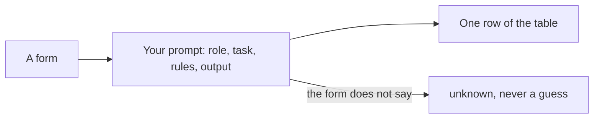

# Ask for a table

## The problem

Forms come in as free text and scans. The office needs one clean row for each child. Each row has the same
fields: name, date of birth, sibling, distance, care status, EHCP and preference. An EHCP is an Education, Health
and Care Plan. It is a legal plan for a child who needs extra support.

You get these rows by writing a prompt. A prompt is the text you give the AI: what to do and how to answer. A
vague prompt gets a nice paragraph. But the office needs a table it can sort. When the form does not say
something, the table must say `unknown`.

For example, form HH-0101 is for Amara Okafor. Her row in the answer key looks like this:

| Child        | Date of birth | Sibling | Distance (km) | Looked after | EHCP | Preference |
| ------------ | ------------- | ------- | ------------- | ------------ | ---- | ---------- |
| Amara Okafor | 2015-03-02    | no      | 0.84          | no           | no   | 1          |

Form HH-0113 for Zainab Hussain has no date of birth. So her row says `unknown` in that field. A good prompt
never lets the AI guess.

Hospitals do this with notes. Manipal Hospitals says AI cut the time for nurse handoff notes. It went from 90
minutes to about 20 minutes per nurse
([Google Cloud's list of use cases](https://cloud.google.com/transform/101-real-world-generative-ai-use-cases-from-industry-leaders)).
The lesson: ask for exactly the shape you need.

This part has four steps. The last one is extra:

| Step                          | Minutes | What you hand in                              | What the check reads                                              |
| ----------------------------- | ------- | --------------------------------------------- | ----------------------------------------------------------------- |
| write-the-brief-prompt        | 10      | `prompts/summary.md`                          | the five prompt sections and the "say unknown" rule               |
| extract-the-fields            | 15      | `applications.csv`                            | 12 rows against the answer key, at least 90% of fields right      |
| fix-the-messy-ones            | 10      | `applications.csv`                            | 18 rows, the three gaps say unknown, the two-home form is flagged |
| draft-the-letter (go further) | 15      | `letters/offer-template.md` and three letters | the five fields, real clauses, short sentences                    |

## Walkthrough

TODO(part session): one `bun run verify` command per step, each with its Expect: line.
