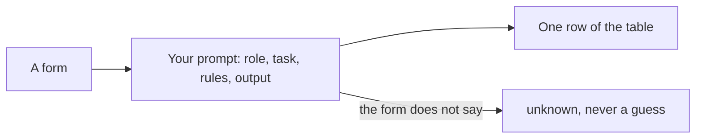

# Ask for a table

## The problem

Forms come in as free text and scans. The office needs one clean row for each child: name, date of birth,
sibling, distance, care status, EHCP and preference. A vague prompt gets a nice paragraph. The office needs a
table it can sort, and the word `unknown` when the form does not say.

Hospitals do this with notes. Manipal Hospitals says AI cut nurse handoff notes "from 90 minutes to approximately
20 minutes per nurse" ([Google Cloud's list of use cases](https://cloud.google.com/transform/101-real-world-generative-ai-use-cases-from-industry-leaders)).
The trick is to ask for exactly the shape you need.

| Step | Minutes | What you hand in | What the check reads |
|---|---|---|---|
| write-the-brief-prompt | 10 | `prompts/summary.md` | the five prompt sections and the "say unknown" rule |
| extract-the-fields | 15 | `applications.csv` | 12 rows against the answer key, at least 90% of fields right |
| fix-the-messy-ones | 10 | `applications.csv` | 18 rows, the three gaps say unknown, the two-home form is flagged |
| draft-the-letter (go further) | 15 | `letters/offer-template.md` and three letters | the five fields, real clauses, short sentences |

## Walkthrough

TODO(part session): one `bun run verify` command per step, each with its Expect: line.
