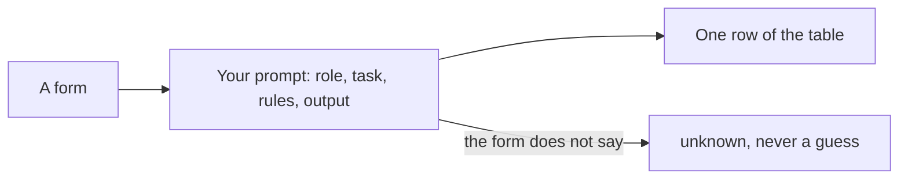

# Ask for a table

## The problem

Forms come in as free text and scans. The office needs one clean row for each child. Each row has the same
fields: name, date of birth, sibling, distance, care status, EHCP and preference. An EHCP is an Education, Health
and Care Plan. It is a legal plan for a child who needs extra support.

You get these rows by writing a prompt. A prompt is the text you give the AI: what to do and how to answer. A
vague prompt gets a nice paragraph. But the office needs a table it can sort. When the form does not say
something, the table must say `unknown`.

For example, form HH-0101 is for Amara Okafor. Her row in the answer key looks like this:

| Child        | Date of birth | Sibling | Distance (km) | Looked after | EHCP | Preference |
| ------------ | ------------- | ------- | ------------- | ------------ | ---- | ---------- |
| Amara Okafor | 2015-03-02    | no      | 0.84          | no           | no   | 1          |

Form HH-0113 for Zainab Hussain has no date of birth. So her row says `unknown` in that field. A good prompt
never lets the AI guess.

Hospitals do this with notes. Manipal Hospitals says AI cut the time for nurse handoff notes. It went from 90
minutes to about 20 minutes per nurse
([Google Cloud's list of use cases](https://cloud.google.com/transform/101-real-world-generative-ai-use-cases-from-industry-leaders)).
The lesson: ask for exactly the shape you need.



This part has four steps. The last one is extra:

| Step                                                                   | Minutes | What you hand in                              | What the check reads                                              |
| ---------------------------------------------------------------------- | ------- | --------------------------------------------- | ----------------------------------------------------------------- |
| [write-the-brief-prompt](01-write-the-brief-prompt/problem/README.md)  | 10      | `prompts/summary.md`                          | the five prompt sections and the "say unknown" rule               |
| [extract-the-fields](02-extract-the-fields/problem/README.md)          | 15      | `applications.csv`                            | 12 rows against the answer key, at least 90% of fields right      |
| [fix-the-messy-ones](03-fix-the-messy-ones/problem/README.md)          | 10      | `applications.csv`                            | 18 rows, the three gaps say unknown, the two-home form is flagged |
| [draft-the-letter](04-draft-the-letter/problem/README.md) (go further) | 15      | `letters/offer-template.md` and three letters | the five fields, real clauses, short sentences                    |

## Walkthrough

You work in Claude.ai and save each answer in the step's `problem` folder. Then you run one command to check
it. The Expect line under each command says what you see once that step's file is filled in.

```bash
bun run verify write-the-brief-prompt
```

Expect: `Done. All 5 rules pass.` once `prompts/summary.md` is filled in.

```bash
bun run verify extract-the-fields
```

Expect: `Done. All 7 rules pass.` once `applications.csv` has the 12 typed forms.

```bash
bun run verify fix-the-messy-ones
```

Expect: `Done. All 6 rules pass.` once `applications.csv` has all 18 forms.

```bash
bun run verify draft-the-letter
```

Expect: `Done. All 7 rules pass.` once the template and three letters are saved.

```bash
bun run verify part ask-for-a-table
```

Expect: `Part ask-for-a-table is done: 4/4 steps pass.`

The table it prints looks like this when every step passes:

```text
Part ask-for-a-table:
  PASS   write-the-brief-prompt  (5/5 rules)
  PASS   extract-the-fields  (7/7 rules)
  PASS   fix-the-messy-ones  (6/6 rules)
  PASS   draft-the-letter  (7/7 rules)
Part ask-for-a-table is done: 4/4 steps pass.
```

Want to see a right answer first? Add the word `solution` after a step name. For example,
`bun run verify extract-the-fields solution` checks the sample table.

## Assignment

**The problem.** Forms arrive as free text and scans. The office needs one row for each child.

**What you hand in.** `prompts/summary.md`, and `applications.csv` with 18 rows.

**How it is marked.** Each line is a yes or a no.

| Question                                                                               | Checked by                              |
| -------------------------------------------------------------------------------------- | --------------------------------------- |
| Does the prompt have Role, Task, Input, Rules and Output format, and the unknown rule? | `bun run verify write-the-brief-prompt` |
| Does the table have the exact first line and all 18 rows?                              | `bun run verify fix-the-messy-ones`     |
| Do at least 90% of the fields match the answer key?                                    | `bun run verify fix-the-messy-ones`     |
| Do the three gaps say unknown, and is the child with two homes flagged?                | `bun run verify fix-the-messy-ones`     |

**Go further.** Do draft-the-letter, and hand in the template and three letters.

## Finished

You now have a prompt with a fixed shape, and a clean table of 18 children. The three gaps say `unknown`, so
nobody acts on a guess. Every form that needs a person is marked.

For example, your table says HH-0114 needs a person, because Finn has two homes. The office will not rank him
until someone has checked.

The next part, give-it-the-policy, answers parents' questions. You give Claude this year's policy, so it quotes
the right clause instead of guessing.
