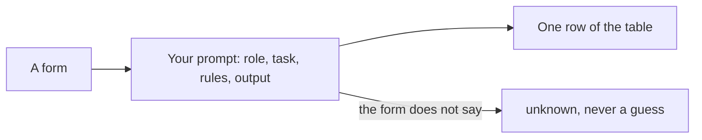

# Ask for a table

## After this part you can

Write a prompt that turns messy forms into a clean table, with unknown for every gap.

## You leave with

A `prompts/summary.md` prompt and an `applications.csv` table of 18 children.

## The problem

Forms come in as free text and scans. The office needs one clean row for each child, with the same fields every time: name, date of birth, sibling, distance, care status, EHCP and preference. An EHCP is an Education, Health and Care Plan, a legal plan for a child who needs extra support.

You get these rows by writing a prompt, the text you give the AI. A vague prompt gets a nice paragraph. The office needs a table it can sort. When the form does not say something, the table must say unknown.

For example, form HH-0101 is for Amara Okafor. Her row in the answer key looks like this:

| Child        | Date of birth | Sibling | Distance (km) | Looked after | EHCP | Preference |
| ------------ | ------------- | ------- | ------------- | ------------ | ---- | ---------- |
| Amara Okafor | 2015-03-02    | no      | 0.84          | no           | no   | 1          |

Form HH-0113 for Zainab Hussain has no date of birth, so her row says unknown there. A good prompt never lets the AI guess.

Hospitals do this with notes. Manipal Hospitals says AI cut the time for nurse handoff notes by more than three quarters ([Google Cloud's list of use cases](https://cloud.google.com/transform/101-real-world-generative-ai-use-cases-from-industry-leaders)). The lesson: ask for exactly the shape you need.



## Steps

The last step is extra.

| Step                                                                   | What you hand in                              | What the check reads                                              |
| ---------------------------------------------------------------------- | --------------------------------------------- | ----------------------------------------------------------------- |
| [write-the-brief-prompt](01-write-the-brief-prompt/problem/README.md)  | `prompts/summary.md`                          | the five prompt sections and the "say unknown" rule               |
| [extract-the-fields](02-extract-the-fields/problem/README.md)          | `applications.csv`                            | 12 rows against the answer key, at least 90% of fields right      |
| [fix-the-messy-ones](03-fix-the-messy-ones/problem/README.md)          | `applications.csv`                            | 18 rows, the three gaps say unknown, the two-home form is flagged |
| [draft-the-letter](04-draft-the-letter/problem/README.md) (go further) | `letters/offer-template.md` and three letters | the five fields, real clauses, short sentences                    |

You work in Claude.ai and save each answer in the step's `problem` folder. Then you run one command to check it.

```bash
bun run verify write-the-brief-prompt
```

Expect: `Done. All 6 rules pass.` once `prompts/summary.md` is filled in.

```bash
bun run verify extract-the-fields
```

Expect: `Done. All 7 rules pass.` once `applications.csv` has the 12 typed forms.

```bash
bun run verify fix-the-messy-ones
```

Expect: `Done. All 6 rules pass.` once `applications.csv` has all 18 forms.

```bash
bun run verify draft-the-letter
```

Expect: `Done. All 7 rules pass.` once the template and three letters are saved.

```bash
bun run verify part ask-for-a-table
```

Expect: `Part ask-for-a-table is done: 4/4 steps pass.`

Want to see a right answer first? Add the word `solution` after a step name, such as `bun run verify extract-the-fields solution`.

## Watch and read

| Kind  | Title                                | Author          | Why                                                | Link                                                                                                  |
| ----- | ------------------------------------ | --------------- | -------------------------------------------------- | ----------------------------------------------------------------------------------------------------- |
| video | AI prompt engineering: A deep dive   | Anthropic       | Anthropic's own prompt team shares how they write prompts | https://www.youtube.com/watch?v=T9aRN5JkmL8                                                    |
| video | Intro to Large Language Models       | Andrej Karpathy | Why a model guesses when it lacks a fact           | https://www.youtube.com/watch?v=zjkBMFhNj_g                                                           |
| read  | Prompt engineering overview          | Anthropic       | The steps for a clear prompt and how to test it    | https://platform.claude.com/docs/en/build-with-claude/prompt-engineering/overview                     |
| read  | Increase output consistency          | Anthropic       | How to fix the shape of an answer                  | https://platform.claude.com/docs/en/test-and-evaluate/strengthen-guardrails/increase-consistency      |
| read  | Vision                               | Anthropic       | How Claude reads a scan or a photo                 | https://platform.claude.com/docs/en/build-with-claude/vision                                          |

## Project

Turn one pile of your own forms or emails into a table. Write the prompt, run it on a messy item, and mark every gap unknown.

For example, your table marks HH-0114 as needing a person, because Finn has two homes. The next part, give-it-the-policy, gives Claude the policy so it quotes the right clause instead of guessing.
