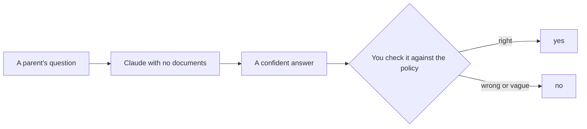
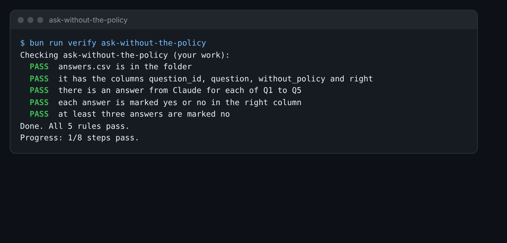

# Ask without the policy

## The problem

A parent asks the office if a stepdaughter counts as a sibling. A plain chat with Claude has never seen Harbour Hill's rules. It answers in a sure voice anyway. So first you find out how many of five answers are wrong.



## Watch it done

Before, the check fails on a blank `answers.csv`:

```text
  FAIL  there is an answer from Claude for each of Q1 to Q5
  FAIL  at least three answers are marked no
```

After, four of the five answers are marked `no`, and the check ends with `Done. All 5 rules pass.`



## Your turn

1. Open Claude.ai and start a new chat. Add no files.
2. Open `answers.csv` in this folder. It has five questions, Q1 to Q5. Ask Claude each one.
3. Paste each answer into the `without_policy` column. If the answer has a comma, put double quotes around it. Keep it on one line.
4. Open `world/harbour-hill/policy/admissions-policy-2027.md`. Find the rule for each question. A clause is one numbered rule, such as clause 5.2.
5. In the `right` column, write `yes` if Claude matches the policy. Write `no` if it is wrong, vague, or says "check with the school".

For example, Q2 asks which address counts for a child with two homes. A plain chat often says the Child Benefit address. The rule in clause 5.2 uses the home where the child sleeps most school nights. So mark it `no`:

```text
Q2,Which address is used for a child with two homes?,Most schools use the address where Child Benefit is paid.,no
```

6. Run the check.

```bash
bun run verify ask-without-the-policy
```

Expect: `Done. All 5 rules pass.`

If you see `FAIL  there is an answer from Claude for...`, paste an answer into every row. If you see `FAIL  at least three answers are marked no`, compare each answer with its clause again. A vague answer is a `no`.

## Do it on your work

Pick five questions your own office or team gets often. Ask a plain chat each one. Mark each answer against your real rules. Good looks like a list of answers you can prove wrong, with the rule beside each.

## Done when

- `answers.csv` has Claude's answer for each of Q1 to Q5.
- Each row is marked `yes` or `no`.
- At least three answers are marked `no`.

## Solution

The after state is a filled `answers.csv`. See `solution/answers.csv`.
