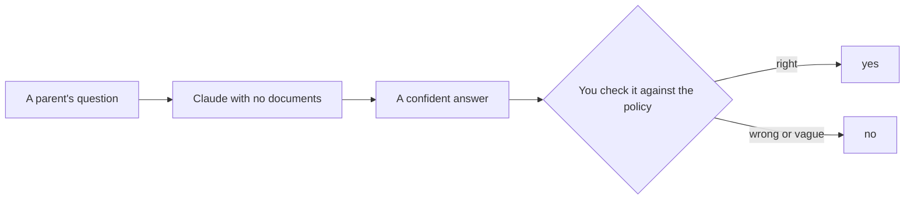
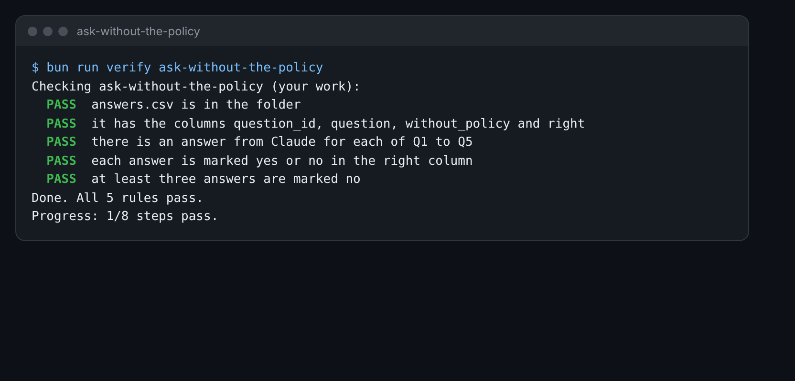

# Ask without the policy

## The problem

Parents email the office with questions. It is tempting to paste each one into Claude and send the reply. But
Claude has never seen Harbour Hill's policy. It knows how many schools work. It does not know this school's own
rules.

So first you find out how often a plain chat gets it wrong.



## Your challenge

`answers.csv` in this folder has five questions from the inbox, Q1 to Q5.

1. Open Claude.ai and start a new chat. Do not add any files.
2. Ask each question. Paste Claude's answer into the `without_policy` column. If the answer has a comma, put
   double quotes around it, like `"Yes, it does."`. Keep it on one line.
3. Open `world/harbour-hill/policy/admissions-policy-2027.md`. Find the rule for each question.
4. In the `right` column, write `yes` if Claude's answer matches the policy. Write `no` if it is wrong, vague, or
   says "check with the school".

For example, Q2 comes from `inbox/02.md`. A parent asks which address counts for a child with two homes. A plain
chat often says the school uses the address where Child Benefit is paid. That was last year's rule. Clause 5.2
of the 2027 policy uses the home where the child sleeps most school nights. So you mark it `no`:

```text
Q2,Which address is used for a child with two homes?,Most schools use the address where Child Benefit is paid.,no
```



## Done when

- `answers.csv` has Claude's answer for each of Q1 to Q5.
- Each row is marked `yes` or `no` in the `right` column.
- At least three answers are marked `no`.

How this step is checked: the check reads your marks. It does not read the chat. If fewer than three are wrong,
look again: Claude does not know this school's rules.

```bash
bun run verify ask-without-the-policy
```

Expect: `Done. All 5 rules pass.`

## If you get stuck

| What you see                                  | Fix                                                            |
| --------------------------------------------- | -------------------------------------------------------------- |
| `FAIL  there is an answer from Claude for...` | Paste an answer into `without_policy` for every row.           |
| `FAIL  at least three answers are marked no`  | Compare each answer with the clause. A vague answer is a `no`. |

## Words you will use

- **Policy**: the school's written rules for who gets a place.
- **Clause**: one numbered rule in the policy, such as clause 5.2.
- **Plain chat**: a chat with Claude where you add no files. Claude only has what it learned before.
