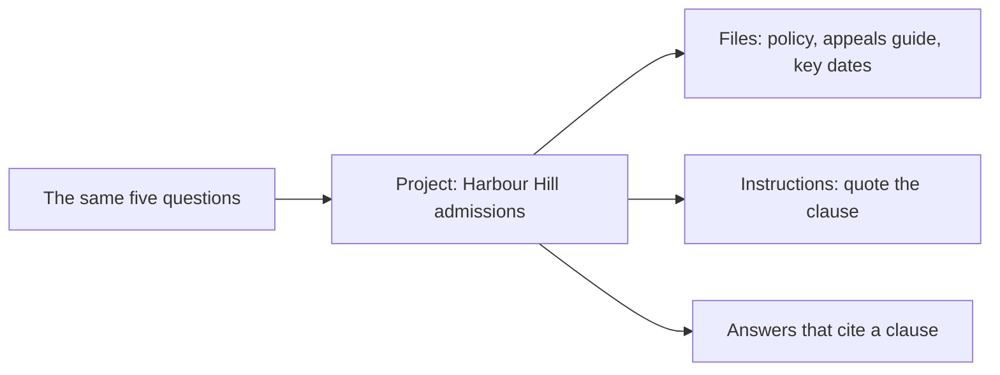
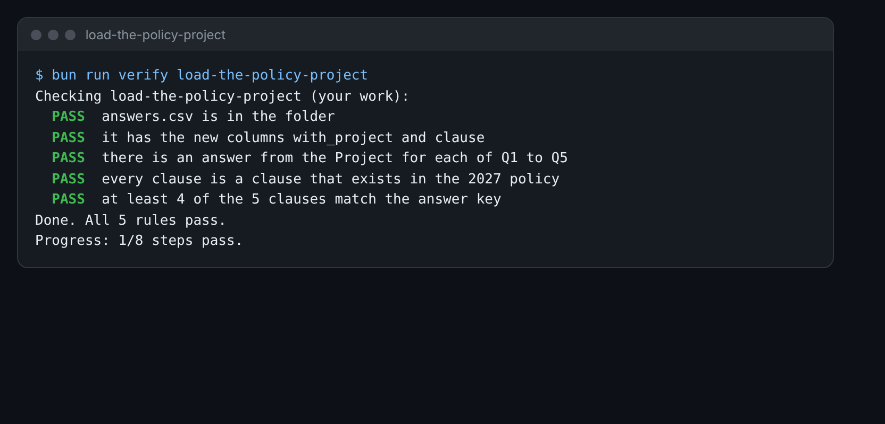

# Load the policy project

## The problem

A plain chat guessed. In Claude.ai, a Project is a space with its own files and instructions. Claude reads them in every chat inside it. You make one for the office, add this year's papers, and ask the same five questions again.



## Watch it done

Before, the check says the new columns are missing:

```text
  FAIL  it has the new columns with_project and clause
  FAIL  at least 4 of the 5 clauses match the answer key
```

After, each row ends with the Project's answer and its clause, and the check ends with `Done. All 5 rules pass.`



## Your turn

1. In Claude.ai, choose **Projects**, then make a new Project. Name it Harbour Hill admissions.
2. Add three files from `world/harbour-hill/policy/`: `admissions-policy-2027.md`, `appeals-guide.md` and `term-dates.md`. Do not add the older policy.
3. In the Project instructions, write: "Answer only from the files. Quote the clause number you used. If the files do not say, say so."
4. In a chat inside the Project, ask Q1 to Q5 again.
5. Open `answers.csv` in this folder. Add `,with_project,clause` to the end of the first line. Paste each new answer and its clause number.

For example, Claude answers Q1 and names clause 4.3. The end of that row is:

```text
"Yes. Clause 4.3 says a stepsister who lives at the same address counts as a sibling.",4.3
```

6. Check each clause yourself. Read it in the policy. Claude can quote a clause that does not answer the question. Then run the check.

```bash
bun run verify load-the-policy-project
```

Expect: `Done. All 5 rules pass.`

If you see `FAIL  every clause is a clause that exists...`, write the number only, like `4.3`. If you see `FAIL  at least 4 of the 5 clauses match...`, read the clause again. Does it answer the question?

## Do it on your work

Make a Project for your own team. Add the two or three documents people ask about most. Use the same instructions. Good looks like answers that name a page or clause you can open and confirm.

## Done when

- `answers.csv` has the columns `with_project` and `clause`.
- Each of Q1 to Q5 has an answer from the Project.
- Every clause exists in this year's policy.
- At least 4 of the 5 clauses match the answer key.

## Solution

The after state is `answers.csv` with the two new columns. See `solution/answers.csv`.
