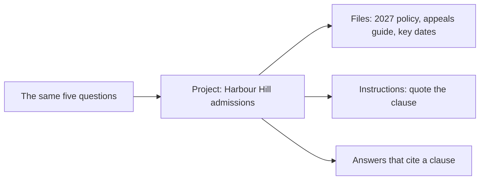
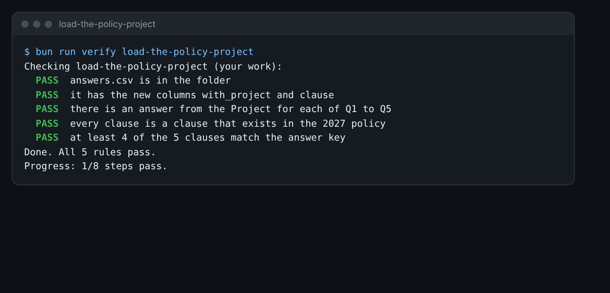

# Load the policy project

## The problem

A plain chat guessed. The fix is to give Claude the right pages before it answers. In Claude.ai, a Project does
this. A Project is a space with its own files and its own instructions. Claude reads them in every chat inside
the Project.

You make a Project for the office, add this year's papers, and ask the same five questions again.



## Your challenge

1. In Claude.ai, choose **Projects**, then make a new Project. Name it `Harbour Hill admissions`. The free plan
   lets you make up to five Projects ([Claude help page](https://support.claude.com/en/articles/9517075-what-are-projects)).
2. Add three files from `world/harbour-hill/policy/`: `admissions-policy-2027.md`, `appeals-guide.md` and
   `term-dates.md`. Do not add the 2026 policy.
3. In the Project instructions, write: "Answer only from the files. Quote the clause number you used. If the files
   do not say, say so."
4. In a chat inside the Project, ask Q1 to Q5 again.
5. `answers.csv` in this folder has your answers from the last step. Add two columns to the end of the first line:
   `with_project` and `clause`. Paste each new answer and its clause number.

For example, Q1 is Jen Wright's question about her partner's daughter. Inside the Project, Claude answers: "Yes.
Clause 4.3 says a stepsister who lives at the same address counts as a sibling." So the end of that row is:

```text
"Yes. Clause 4.3 says a stepsister who lives at the same address counts as a sibling.",4.3
```

Check each clause yourself. Open the policy and read it. Claude can quote a clause that does not answer the
question.



## Done when

- `answers.csv` has the columns `with_project` and `clause`.
- Each of Q1 to Q5 has an answer from the Project.
- Every clause is a clause that exists in the 2027 policy.
- At least 4 of the 5 clauses match the answer key.

How this step is checked: the check reads the clause numbers. It checks that each one is in the policy, and
compares them with the answer key.

```bash
bun run verify load-the-policy-project
```

Expect: `Done. All 5 rules pass.`

## If you get stuck

| What you see                                           | Fix                                                               |
| ------------------------------------------------------ | ----------------------------------------------------------------- |
| `FAIL  it has the new columns with_project and clause` | Add `,with_project,clause` to the end of the first line.          |
| `FAIL  every clause is a clause that exists...`        | Write the number only, like `4.3`. Find it in the policy first.   |
| `FAIL  at least 4 of the 5 clauses match...`           | Read the clause. Does it answer the question? If not, look again. |

## Words you will use

- **Project**: a space in Claude.ai with its own files and instructions.
- **Project knowledge**: the files you add to a Project. Claude reads them before it answers.
- **Grounded answer**: an answer that comes from a document you gave, and says where.
