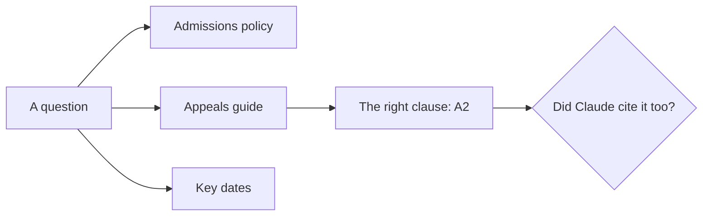
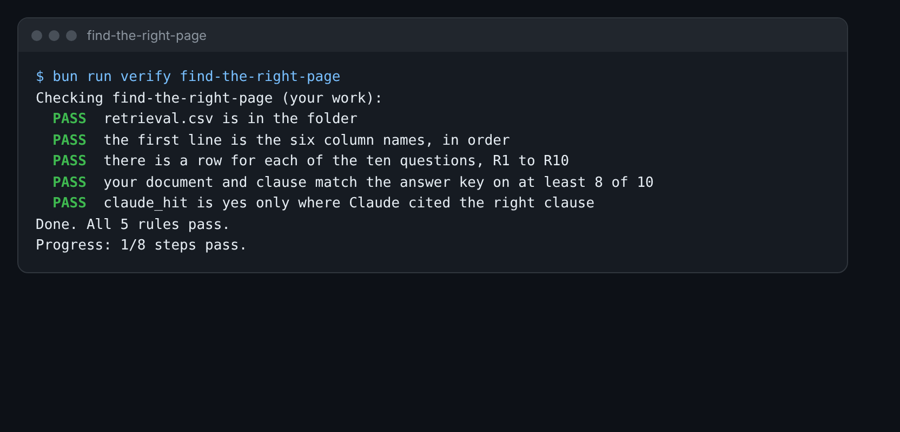

# Find the right page

## The problem

Claude now has three documents. To answer a question, it must find the right one, and the right clause in it.
This is called retrieval. If it picks the wrong page, the answer is wrong, even with the right files in the
Project.

To judge Claude's pick, you need to know the right page yourself. So you find it first. Then you compare.



## Your challenge

`retrieval.csv` in this folder has ten questions, R1 to R10.

1. For each question, find the answer yourself in `world/harbour-hill/policy/`. Write the file name in `document`
   and the clause in `clause`. The appeals guide numbers its clauses A1 to A7. The key dates are T1 to T6.
2. Ask each question in your Harbour Hill Project. Write the clause Claude quoted in `claude_clause`.
3. In `claude_hit`, write `yes` if Claude's clause is the one that holds the answer. Otherwise write `no`.

For example, R7 asks: how long do families have to appeal? The answer is in the appeals guide, clause A2. Claude
may quote clause 10.1 of the policy instead. That clause says families can appeal, but not how long they have.
So it is a miss:

```text
R7,How long do families have to appeal?,appeals-guide.md,A2,10.1,no
```



## Done when

- `retrieval.csv` has a row for each of R1 to R10.
- Your document and clause match the answer key on at least 8 of 10.
- `claude_hit` is `yes` only where Claude cited the right clause.

How this step is checked: the check compares your picks with the answer key. Then it checks your `claude_hit`
marks against your own `claude_clause` column.

```bash
bun run verify find-the-right-page
```

Expect: `Done. All 5 rules pass.`

## If you get stuck

| What you see                                         | Fix                                                                 |
| ---------------------------------------------------- | ------------------------------------------------------------------- |
| `FAIL  your document and clause match the answer...` | Three answers are in the appeals guide or the key dates.            |
| `FAIL  claude_hit is yes only where Claude cited...` | A hit means Claude's clause holds the answer, not that it is close. |

## Words you will use

- **Retrieval**: finding the right piece of a document before you answer.
- **Hit**: Claude cited the clause that holds the answer.
- **Miss**: Claude cited a clause, but not the one that answers the question.
