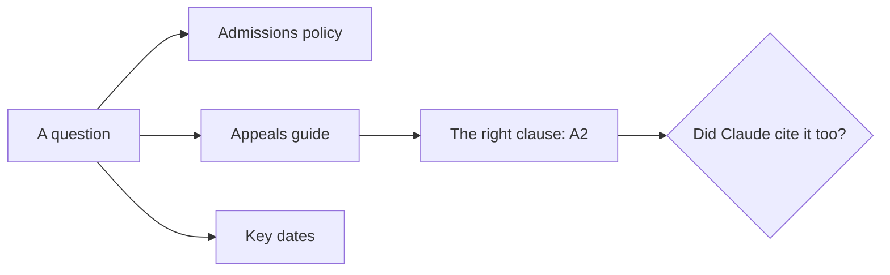
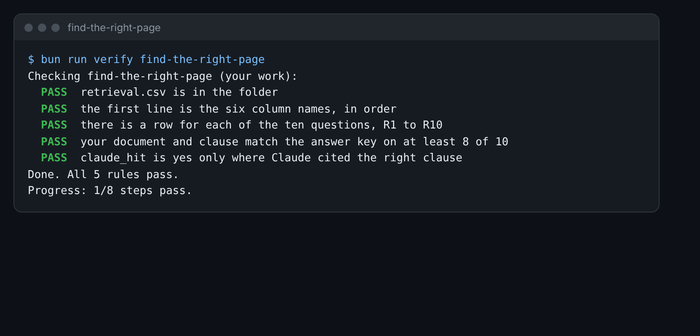

# Find the right page

## The problem

The Project holds three documents. To answer, Claude must find the right document and the right clause. That is called retrieval. A wrong pick gives a wrong answer, even with the right files loaded. To judge Claude, find the page yourself first.



## Watch it done

Before, the picks and habits are blank:

```text
  FAIL  your document and clause match the answer key on at least 8 of 10
  FAIL  checking-habits.md has your own rule for when to check, in a full sentence
```

After, eight of ten picks match. Two misses are named, and the check ends with `Done. All 8 rules pass.`



## Your turn

1. Open `retrieval.csv` in this folder. It has ten questions, R1 to R10.
2. For each one, find the answer yourself in `world/harbour-hill/policy/`. Write the file name in `document` and the clause in `clause`. The appeals guide numbers its clauses A1 to A7. The key dates are T1 to T6.
3. Ask each question in your Project. Write the clause Claude quoted in `claude_clause`.
4. In `claude_hit`, write `yes` if Claude's clause holds the answer. Otherwise write `no`.

For example, R7 asks how long families have to appeal. The answer is in the appeals guide, clause A2. Claude may quote clause 10.1 instead. That clause says families can appeal, but not how long they have. So it is a miss:

```text
R7,How long do families have to appeal?,appeals-guide.md,A2,10.1,no
```

5. Open `checking-habits.md`. Name each question where Claude missed. Say how you caught it. Write one rule for when you open the source before you trust Claude.
6. Run the check.

```bash
bun run verify find-the-right-page
```

Expect: `Done. All 8 rules pass.`

If you see `FAIL  your document and clause match the answer...`, remember that three answers are in the appeals guide or the key dates. If you see `FAIL  claude_hit is yes only where...`, a hit means Claude's clause holds the answer. A close clause is not a hit.

## Do it on your work

Pick ten questions your own documents can answer. Find each page yourself, then ask Claude and compare. A good answer has a hit count you trust, and a written rule for when to open the source.

## Done when

- `retrieval.csv` has a row for each of R1 to R10.
- Your document and clause match the answer key on at least 8 of 10.
- `claude_hit` is `yes` only where Claude cited the right clause.
- `checking-habits.md` names each miss, says how you caught it, and has your own rule.

## Solution

The finished state is a filled `retrieval.csv` and `checking-habits.md`. See the `solution/` folder.
