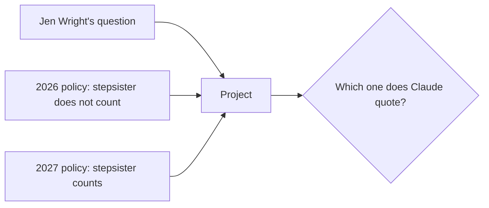
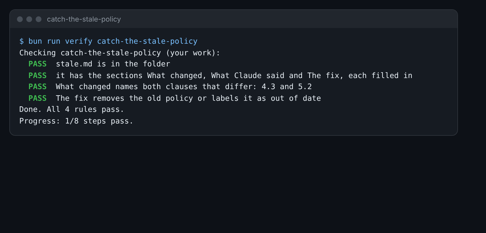

# Catch the stale policy

This step is extra. Do it if you have time, or come back to it later.

## The problem

Offices keep old files. Someone adds last year's policy to the Project, in case it helps. Now Claude has two policies
with the same clause numbers. Some rules changed. Claude may quote the old one, and it will sound as sure as ever.

A stale file is an old file that is no longer true. You find out what it does to the answers, and how to stop it.



## Your challenge

1. Open both policies in `world/harbour-hill/policy/`. Compare clause 4.3, then clause 5.2.
2. Add `admissions-policy-2026.md` to your Harbour Hill Project.
3. Ask Q1 and Q2 again, from `answers.csv` in load-the-policy-project.
4. Fill in `stale.md` in this folder:
   - **What changed**: the two clauses, and how each one changed.
   - **What Claude said**: what it answered with both files in the Project.
   - **The fix**: what you do with the old file so this cannot happen again.

For example, here is the Q1 answer with both files:

```text
Clause 4.3 says stepbrothers and stepsisters do not count. So your stepdaughter would not count as a sibling.
```

That is the 2026 rule. Under the 2027 policy, she counts. A parent who trusts it may not apply, or may appeal.



## Done when

- `stale.md` has the sections What changed, What Claude said and The fix, each filled in.
- What changed names both clauses that differ: 4.3 and 5.2.
- The fix removes the old policy from the Project, or labels it as out of date.

How this step is checked: the check reads your notes. It looks for both clause numbers, and for a fix that
removes or labels the old file.

```bash
bun run verify catch-the-stale-policy
```

Expect: `Done. All 4 rules pass.`

## If you get stuck

| What you see                                           | Fix                                                               |
| ------------------------------------------------------ | ----------------------------------------------------------------- |
| `FAIL  What changed names both clauses that differ...` | Name both 4.3 and 5.2 under What changed.                         |
| `FAIL  The fix removes the old policy or labels...`    | Say what happens to the 2026 file: remove it, or label it as old. |

## Words you will use

- **Stale**: old and no longer true, but still in the files.
- **Out of date**: replaced by a newer version.
