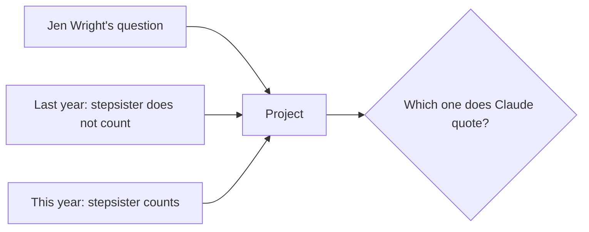
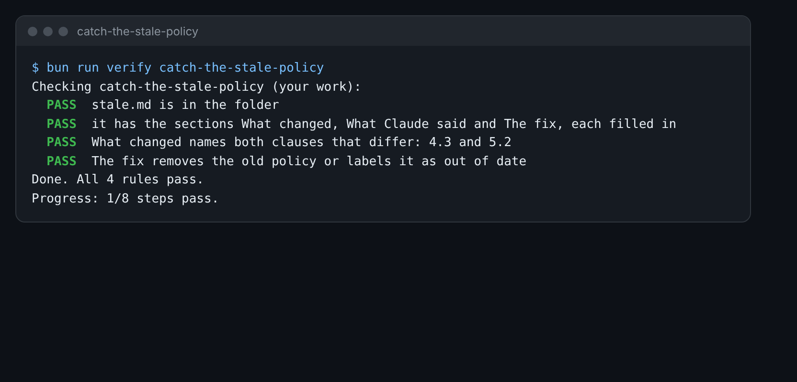

# Catch the stale policy

This step is extra. Do it if you have time.

## The problem

Someone adds last year's policy to the Project, in case it helps. Now Claude holds two policies with the same clause numbers. Two rules changed. Claude may quote the old one and sound just as sure. A stale file is an old file that is no longer true.



## Watch it done

Before, the notes are blank:

```text
  FAIL  What changed names both clauses that differ: 4.3 and 5.2
  FAIL  The fix removes the old policy from the Project
```

After, the notes name both clauses and say the old file is removed. The check ends with `Done. All 4 rules pass.`



## Your turn

1. Open both policies in `world/harbour-hill/policy/`. Compare clause 4.3, then clause 5.2.
2. Add last year's policy file to your Project.
3. Ask Q1 and Q2 again, from `answers.csv` in load-the-policy-project.
4. Fill in `stale.md` in this folder under three headings: what changed, what Claude said, and the fix.

For example, with both files in, Claude says:

```text
Clause 4.3 says stepbrothers and stepsisters do not count. So your stepdaughter would not count as a sibling.
```

That is last year's rule. This year she counts. A parent who trusts it may not apply, or may appeal.

5. Run the check.

```bash
bun run verify catch-the-stale-policy
```

Expect: `Done. All 4 rules pass.`

If you see `FAIL  What changed names both clauses...`, name both 4.3 and 5.2. If you see `FAIL  The fix removes the old policy...`, say you remove the old file. A label does not stop Claude reading it.

## Do it on your work

Look in your own Project or folder for two versions of one document. Compare them and list what changed. Good looks like the old version removed, and one line in the instructions saying which version to use.

## Done when

- `stale.md` has all three sections filled in.
- What changed names both clauses: 4.3 and 5.2.
- The fix removes the old policy from the Project.

## Solution

The after state is a filled `stale.md`. See `solution/stale.md`.
