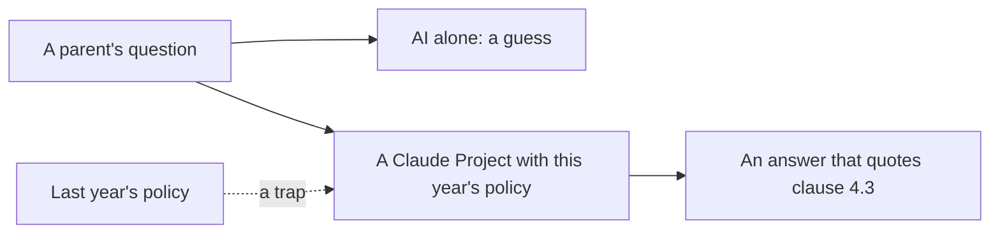

# Give it the policy

## After this part you can

Put the right documents in front of Claude, and check every clause it quotes.

## You leave with

A Claude Project that holds this year's policy, plus `answers.csv` and `retrieval.csv` with every clause checked.

## The problem

Parents ask the office questions by email, and the answer is in the school's policy, the written rules for who gets a place. Each rule has a number, called a clause. For example, Jen Wright asks if her partner's daughter counts as her son's sibling. This year's policy says yes, in clause 4.3. Last year's said no. An AI with no policy guesses, sounds sure, and may use last year's rules. A wrong answer can become an appeal. West Sussex County Council runs "14 unique generative AI agents". They help staff find policy guides and the law ([Google Cloud's list of use cases](https://cloud.google.com/transform/101-real-world-generative-ai-use-cases-from-industry-leaders)). In this part you give Claude the right pages in a Claude Project, a space where you add files that Claude reads before it answers.



## Steps

You work in Claude.ai and save each answer in the step's `problem` folder. Then you run one command to check it. The last step is extra.

| Step                                                                               | What you hand in                  | What the check reads                                   |
| ---------------------------------------------------------------------------------- | --------------------------------- | ------------------------------------------------------ |
| [ask-without-the-policy](01-ask-without-the-policy/problem/README.md)              | `answers.csv`                     | five answers, and which ones you marked wrong          |
| [load-the-policy-project](02-load-the-policy-project/problem/README.md)            | `answers.csv` with clause columns | every clause exists, at least 4 of 5 match the key     |
| [find-the-right-page](03-find-the-right-page/problem/README.md)                    | `retrieval.csv`                   | your picks for ten questions, at least 8 match the key |
| [catch-the-stale-policy](04-catch-the-stale-policy/problem/README.md) (go further) | `stale.md`                        | the two clauses that changed, and the fix              |

```bash
bun run verify ask-without-the-policy
```

Expect: `Done. All 5 rules pass.` once `answers.csv` has five marked answers.

```bash
bun run verify load-the-policy-project
```

Expect: `Done. All 5 rules pass.` once `answers.csv` has the Project's answers and clauses.

```bash
bun run verify find-the-right-page
```

Expect: `Done. All 8 rules pass.` once `retrieval.csv` has all ten rows and `checking-habits.md` is filled in.

```bash
bun run verify catch-the-stale-policy
```

Expect: `Done. All 4 rules pass.` once `stale.md` is filled in.

```bash
bun run verify part give-it-the-policy
```

Expect: `Part give-it-the-policy is done: 4/4 steps pass.`

Want to see a right answer first? Add the word `solution` after a step name. For example, `bun run verify find-the-right-page solution` checks the sample answers.

## Watch and read

| Kind | Title                    | Author             | Why                                                            | Link                                                                                          |
| ---- | ------------------------ | ------------------ | -------------------------------------------------------------- | --------------------------------------------------------------------------------------------- |
| read | Reduce hallucinations    | Anthropic docs     | Ways to make Claude quote its sources and say "I do not know". | https://docs.claude.com/en/docs/test-and-evaluate/strengthen-guardrails/reduce-hallucinations |
| read | Contextual retrieval     | Anthropic          | Why finding the right page matters, and how to improve it.     | https://www.anthropic.com/news/contextual-retrieval                                           |
| read | What are projects?       | Claude Help Center | How a Project holds files and instructions.                    | https://support.claude.com/en/articles/9517075-what-are-projects                              |
| read | Prompting best practices | Anthropic docs     | Put long documents first and ask Claude to quote them.         | https://docs.claude.com/en/docs/build-with-claude/prompt-engineering/long-context-tips        |

## Project

Make a Claude Project for one real set of documents you own. Ask it five questions, and check every clause or page it cites.
