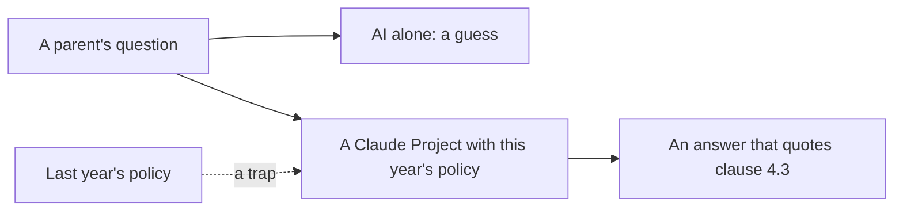

# Give it the policy

## The problem

Parents ask "does my stepdaughter count as a sibling?" The answer is clause 4.3 of this year's policy. An AI
with no policy will guess, and it will sound sure. A wrong answer can turn into an appeal.

West Sussex County Council serves 890,000 residents. It says it runs "14 unique generative AI agents" that help
staff find policy guides and the law
([Google Cloud's list of use cases](https://cloud.google.com/transform/101-real-world-generative-ai-use-cases-from-industry-leaders)).
A newspaper on the same list, JoongAng Ilbo, limits search to its own articles "to eliminate hallucinations".
The lesson is the same: give the AI the right pages.

| Step                                | Minutes | What you hand in                  | What the check reads                                   |
| ----------------------------------- | ------- | --------------------------------- | ------------------------------------------------------ |
| ask-without-the-policy              | 5       | `answers.csv`                     | five answers, and which ones you marked wrong          |
| load-the-policy-project             | 15      | `answers.csv` with clause columns | every clause exists, at least 4 of 5 match the key     |
| find-the-right-page                 | 10      | `retrieval.csv`                   | your picks for ten questions, at least 8 match the key |
| catch-the-stale-policy (go further) | 15      | `stale.md`                        | the two clauses that changed, and the fix              |

## Walkthrough

TODO(part session): one `bun run verify` command per step, each with its Expect: line.
