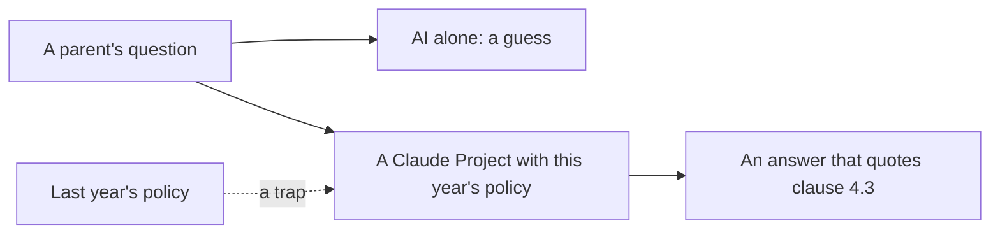

# Give it the policy

## The problem

Parents ask the office questions by email. The answer is in the school's policy, the written rules for who gets
a place. Each rule has a number, called a clause.

For example, Jen Wright writes in `inbox/01.md`. Her partner's daughter is in Year 9 and lives with them. Her son
is applying for Year 7. She asks: does the stepdaughter count as his sibling? This year's policy says yes, in
clause 4.3. Last year's policy said no.

An AI with no policy will guess, and it will sound sure. It may also use last year's rules. A wrong answer can
turn into an appeal, where the family asks for the decision to be looked at again.

West Sussex County Council serves 890,000 residents. It says it runs "14 unique generative AI agents" that help
staff find policy guides and the law
([Google Cloud's list of use cases](https://cloud.google.com/transform/101-real-world-generative-ai-use-cases-from-industry-leaders)).
A newspaper on the same list, JoongAng Ilbo, limits search to its own articles "to eliminate hallucinations". A
hallucination is when the AI makes up a fact. The lesson is the same in both: give the AI the right pages.

In this part you put the policy in a Claude Project. A Claude Project is a space in Claude where you add files.
Claude reads those files before it answers.

This part has four steps. The last one is extra:

| Step                                | Minutes | What you hand in                  | What the check reads                                   |
| ----------------------------------- | ------- | --------------------------------- | ------------------------------------------------------ |
| ask-without-the-policy              | 5       | `answers.csv`                     | five answers, and which ones you marked wrong          |
| load-the-policy-project             | 15      | `answers.csv` with clause columns | every clause exists, at least 4 of 5 match the key     |
| find-the-right-page                 | 10      | `retrieval.csv`                   | your picks for ten questions, at least 8 match the key |
| catch-the-stale-policy (go further) | 15      | `stale.md`                        | the two clauses that changed, and the fix              |

## Walkthrough

TODO(part session): one `bun run verify` command per step, each with its Expect: line.
