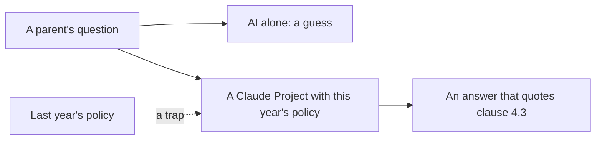

# Give it the policy

## The problem

Parents ask the office questions by email. The answer is in the school's policy, the written rules for who gets
a place. Each rule has a number, called a clause.

For example, Jen Wright writes in `inbox/01.md`. Her partner's daughter is in Year 9 and lives with them. Her son
is applying for Year 7. She asks: does the stepdaughter count as his sibling? This year's policy says yes, in
clause 4.3. Last year's policy said no.

An AI with no policy will guess, and it will sound sure. It may also use last year's rules. A wrong answer can
turn into an appeal, where the family asks for the decision to be looked at again.

West Sussex County Council serves 890,000 residents. It says it runs "14 unique generative AI agents" that help
staff find policy guides and the law
([Google Cloud's list of use cases](https://cloud.google.com/transform/101-real-world-generative-ai-use-cases-from-industry-leaders)).
A newspaper on the same list, JoongAng Ilbo, limits search to its own articles "to eliminate hallucinations". A
hallucination is when the AI makes up a fact. The lesson is the same in both: give the AI the right pages.

In this part you put the policy in a Claude Project. A Claude Project is a space in Claude where you add files.
Claude reads those files before it answers.



This part has four steps. The last one is extra:

| Step                                                                               | Minutes | What you hand in                  | What the check reads                                   |
| ---------------------------------------------------------------------------------- | ------- | --------------------------------- | ------------------------------------------------------ |
| [ask-without-the-policy](01-ask-without-the-policy/problem/README.md)              | 5       | `answers.csv`                     | five answers, and which ones you marked wrong          |
| [load-the-policy-project](02-load-the-policy-project/problem/README.md)            | 15      | `answers.csv` with clause columns | every clause exists, at least 4 of 5 match the key     |
| [find-the-right-page](03-find-the-right-page/problem/README.md)                    | 10      | `retrieval.csv`                   | your picks for ten questions, at least 8 match the key |
| [catch-the-stale-policy](04-catch-the-stale-policy/problem/README.md) (go further) | 15      | `stale.md`                        | the two clauses that changed, and the fix              |

## Walkthrough

You work in Claude.ai and save each answer in the step's `problem` folder. Then you run one command to check
it. The Expect line under each command says what you see once that step's file is filled in.

```bash
bun run verify ask-without-the-policy
```

Expect: `Done. All 5 rules pass.` once `answers.csv` has five marked answers.

```bash
bun run verify load-the-policy-project
```

Expect: `Done. All 5 rules pass.` once `answers.csv` has the Project's answers and clauses.

```bash
bun run verify find-the-right-page
```

Expect: `Done. All 5 rules pass.` once `retrieval.csv` has all ten rows.

```bash
bun run verify catch-the-stale-policy
```

Expect: `Done. All 4 rules pass.` once `stale.md` is filled in.

```bash
bun run verify part give-it-the-policy
```

Expect: `Part give-it-the-policy is done: 4/4 steps pass.`

The table it prints looks like this when every step passes:

```text
Part give-it-the-policy:
  PASS   ask-without-the-policy  (5/5 rules)
  PASS   load-the-policy-project  (5/5 rules)
  PASS   find-the-right-page  (5/5 rules)
  PASS   catch-the-stale-policy  (4/4 rules)
Part give-it-the-policy is done: 4/4 steps pass.
```

Want to see a right answer first? Add the word `solution` after a step name. For example,
`bun run verify find-the-right-page solution` checks the sample answers.

## Assignment

**The problem.** Parents ask policy questions. A wrong answer can turn into an appeal.

**What you hand in.** `answers.csv` with the `with_project` and `clause` columns, and `retrieval.csv`.

**How it is marked.** Each line is a yes or a no.

| Question                                                                  | Checked by                               |
| ------------------------------------------------------------------------- | ---------------------------------------- |
| Is every clause in `answers.csv` a clause that exists in the 2027 policy? | `bun run verify load-the-policy-project` |
| Do at least 4 of the 5 clauses match the answer key?                      | `bun run verify load-the-policy-project` |
| Do at least 8 of your 10 picks in `retrieval.csv` match the answer key?   | `bun run verify find-the-right-page`     |
| Is `claude_hit` yes only where Claude cited the right clause?             | `bun run verify find-the-right-page`     |

**Go further.** Add last year's policy, catch the two changed clauses, and hand in `stale.md`.

## Finished

You now have a Claude Project that holds this year's policy, the appeals guide and the key dates. Its answers
quote a clause, and you have checked each clause yourself. You also know which questions Claude still gets
wrong.

For example, Jen Wright's question now gets "Yes, clause 4.3" instead of a guess. And you know to keep last
year's policy out of the Project.

The next part, let-it-act-safely, goes one step further. Claude stops only answering. It changes the waiting list
with tools, and a person approves every change.
