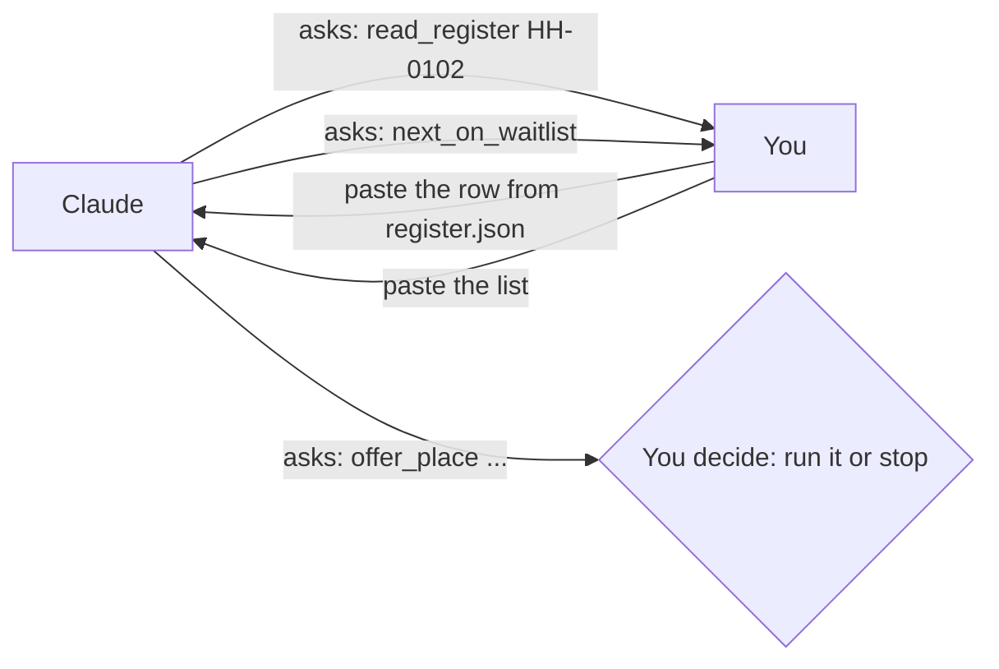
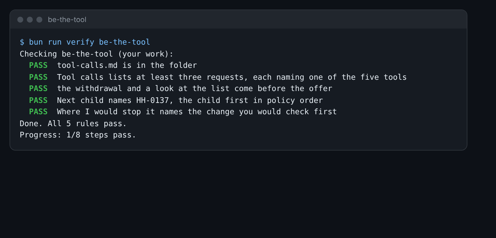

# Be the tool

## The problem

An agent is an AI that does steps, using tools. A tool is a small action the AI asks for, such as "read the register". Something outside the AI runs it.

Before you trust that, you be the tool by hand. Position 1 on the waiting list looks right, but is not.



## Watch it done

Before, the notes are blank:

```text
  FAIL  Next child names HH-0137, the child first in policy order
  FAIL  Where I would stop it names the change you would check first
```

After, the notes list the calls in order and name HH-0137. The check ends with `Done. All 5 rules pass.`



## Your turn

1. Open Claude.ai and start a new chat. Paste this prompt:

```text
You help the Harbour Hill School admissions office. You may ask me to run these tools,
one at a time: read_register (one child, or all), next_on_waitlist, withdraw, offer_place,
draft_letter. Write each request on its own line, like: TOOL read_register HH-0102.
Then wait for my answer. Follow the admissions policy I paste below.
Task: process this email.
```

2. Under it, paste `world/harbour-hill/inbox/07.md` and `policy/admissions-policy-2027.md`.
3. Each time Claude asks for a tool, find the answer in `world/harbour-hill/register.json`. Paste it back.
4. When Claude asks for `offer_place`, do not run it. Stop and check the child yourself.
5. Fill in `tool-calls.md` in this folder: each request in order, the next child, and where you would stop it.

For example, Claude asks `TOOL next_on_waitlist`. You paste the waiting children. Position 1 is HH-0116, Lily Chen, by distance.

But HH-0137, Zara Ahmed, is at position 22 as a sibling, under clause 4.3. The list keeps policy order (clause 7.2), so a sibling comes first. If Claude offers the place to HH-0116, stop it there.

6. Run the check.

```bash
bun run verify be-the-tool
```

Expect: `Done. All 5 rules pass.`

If you see `FAIL  Next child names HH-0137...`, position 1 is not the answer. Look for a sibling lower on the list. If you see `FAIL  the withdrawal and a look at the list...`, write the calls in the order Claude asked for them.

## Do it on your work

Pick one job in your own work that an AI could do in steps. List each tool it would need and write what each returns. Good looks like one line you would never let run without a person.

## Done when

- `tool-calls.md` lists at least three requests, in order, each naming one of the five tools.
- The withdrawal and a look at the list come before the offer.
- Next child names HH-0137.
- Where I would stop it names the change you would check first.

## Solution

The after state is a filled `tool-calls.md`. See `solution/tool-calls.md`.
