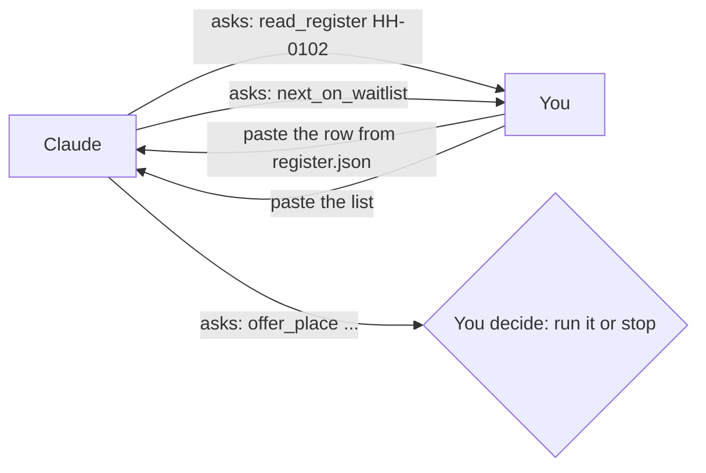
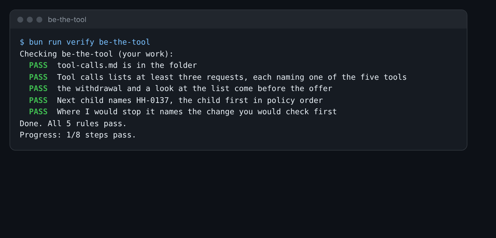

# Be the tool

## The problem

An agent is an AI that does steps, not only talk. It does them with tools. A tool is a small action the AI may
ask for, such as "read the register". Something outside the AI runs the tool and sends back the result.

It is easier to trust once you have seen it. So first, you are the tool. Claude asks. You look up the answer in the
register and paste it back. You see every step the agent takes, and where it could go wrong.



## Your challenge

1. Open Claude.ai and start a new chat. Paste this prompt:

```text
You help the Harbour Hill School admissions office. You may ask me to run these tools,
one at a time: read_register (one child, or all), next_on_waitlist, withdraw, offer_place,
draft_letter. Write each request on its own line, like: TOOL read_register HH-0102.
Then wait for my answer. Follow the admissions policy I paste below.
Task: process this email.
```

2. Under it, paste `world/harbour-hill/inbox/07.md` and `policy/admissions-policy-2027.md`.
3. Each time Claude asks for a tool, find the answer in `world/harbour-hill/register.json`. Paste it back.
4. When Claude asks for `offer_place`, do not run it. Stop and check the child yourself.
5. Fill in `tool-calls.md` in this folder: each request in order, the next child, and where you would stop it.

For example, Claude may ask `TOOL next_on_waitlist`. You paste the waiting children. Position 1 is HH-0116, Lily
Chen, under clause 4.4 (distance). But HH-0137, Zara Ahmed, is at position 22 under clause 4.3 (sibling). Clause
7.2 keeps the list in policy order, so a sibling comes before distance. If Claude asks to offer the place to
HH-0116, that is the moment to stop it.



## Done when

- `tool-calls.md` lists at least three tool requests, in order, each naming one of the five tools.
- The withdrawal and a look at the list come before the offer.
- Next child names HH-0137.
- Where I would stop it names the change you would check first.

How this step is checked: the check reads your notes. It does not read the chat.

```bash
bun run verify be-the-tool
```

Expect: `Done. All 5 rules pass.`

## If you get stuck

| What you see                                     | Fix                                                                 |
| ------------------------------------------------ | ------------------------------------------------------------------- |
| `FAIL  Next child names HH-0137...`              | Position 1 is not the answer. Look for a sibling lower on the list. |
| `FAIL  the withdrawal and a look at the list...` | Write the calls in the order Claude asked for them.                 |

## Words you will use

- **Agent**: an AI that takes steps on its own, with tools.
- **Tool**: a small action the AI may ask for. Something else runs it and sends back the result.
- **Tool call**: one request from the AI to run one tool, such as `read_register HH-0102`.
