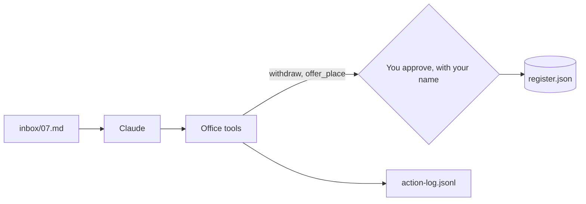
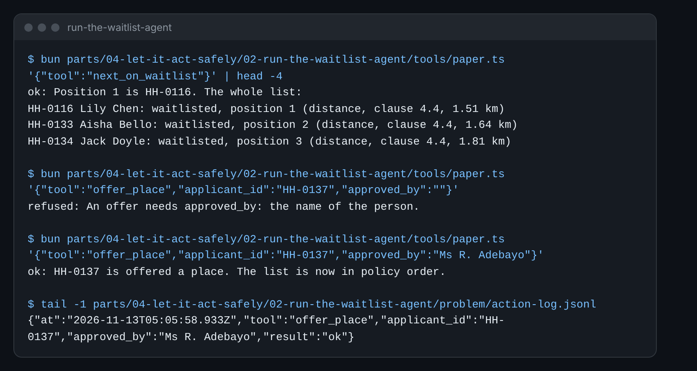

# Run the waitlist agent

## The problem

You played the tools by hand. Now real tools change a copy of the register, and write an action log. The log lists every tool call, for whom, who approved it, and the result. Each change needs a person's name in `approved_by`, or the tool refuses it.



## Watch it done

Before, the folder is empty:

```text
  FAIL  action-log.jsonl is in the folder
  FAIL  the only offer went to HH-0137, the child first in policy order
```

After, the log shows a withdrawal for HH-0102 and one offer to HH-0137. The check ends with `Done. All 8 rules pass.`



## Your turn

Use the paper register. It needs no install. Ask Claude in Claude.ai to write each tool call as one line of JSON. Give it this list of fields:

```text
Write each tool call as one line of JSON. The tools and their fields are:
{"tool":"read_register","applicant_id":"HH-0102"}
{"tool":"next_on_waitlist"}
{"tool":"withdraw","applicant_id":"...","from_email":"the sender of the email","approved_by":"..."}
{"tool":"offer_place","applicant_id":"...","approved_by":"..."}
{"tool":"draft_letter","applicant_id":"...","text":"the whole letter"}
```

1. Paste the email `inbox/07.md` and the policy. Claude asks to withdraw Leo Brennan's place. Add your name, and run it:

```bash
bun parts/04-let-it-act-safely/02-run-the-waitlist-agent/tools/paper.ts '{"tool":"withdraw","applicant_id":"HH-0102","from_email":"siobhan.brennan@example.com","approved_by":"Your Name"}'
```

Expect: `ok: HH-0102 is withdrawn. One place is free.`

2. Paste the result back. Run the other calls the same way. Before you approve `offer_place`, check the child against clause 7.2. The right child is not position 1.
3. Last, have Claude draft the offer letter with `draft_letter`. For example:

```text
{"tool":"draft_letter","applicant_id":"HH-0137","text":"Dear Ms Ahmed, we can offer Zara a place in Year 7."}
```

4. Run the check.

```bash
bun run verify run-the-waitlist-agent
```

Expect: `Done. All 8 rules pass.`

If you see `FAIL  the only offer went to HH-0137...`, delete `action-log.jsonl` and `register.json` in this folder, and start again. Check clause 7.2. If you see `refused: An offer needs approved_by...`, put your name in `approved_by`.

## Do it on your work

Go further: run the same tools in Claude Desktop. Print the setting with `bun parts/04-let-it-act-safely/02-run-the-waitlist-agent/tools/paper.ts desktop-config`. Expect: `"harbour-hill-office": {`.

In Claude Desktop, open **Settings**, then **Developer**, then **Edit Config**. Paste the setting you printed, and restart.

MCP is how Claude Desktop talks to tools on your computer. Claude types the `approved_by` name itself there. So the real stop is when Claude Desktop asks you to allow the call. If the tools do not show, run `which bun` and use that full path.

For your own work, name one change an agent could make, and who must say yes. A good answer has a name on every change in the log.

## Done when

- The log shows `withdraw` for HH-0102 and one `offer_place`, for HH-0137.
- The log shows `draft_letter` for HH-0137.
- Every `withdraw` and `offer_place` that went through has a name in `approved_by`.
- `register.json` shows HH-0102 withdrawn, HH-0137 offered, and the list in policy order.

## Solution

The finished state is `action-log.jsonl` and `register.json`. See the `solution/` folder.
