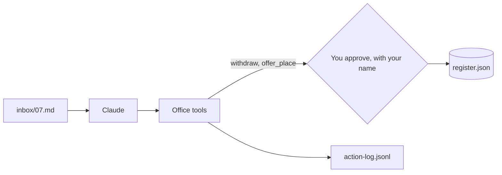
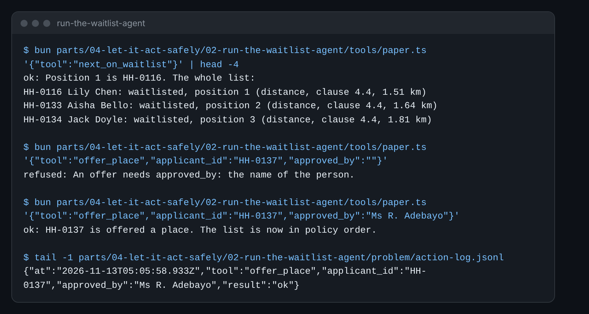

# Run the waitlist agent

## The problem

You played the tools by hand. Now real tools do the work. They change a copy of the register and write an action
log. The log is a list of every tool call: what, for whom, who approved it, and the result. Each change needs a
person's name in `approved_by`, or the tool refuses it.

Be careful: in Claude Desktop, Claude fills in `approved_by` itself. The tool only checks that a name is there. The
real stop is the moment Claude Desktop asks you to allow the call. In a real office, the name comes from the
person who logs in, not from the AI.



## Your challenge

Pick one way to run the tools. Both write `action-log.jsonl` and `register.json` into this folder.

**Way 1: Claude Desktop.** Run this in the course folder. It prints the setting Claude Desktop needs:

```bash
bun parts/04-let-it-act-safely/02-run-the-waitlist-agent/tools/paper.ts desktop-config
```

Expect: `"harbour-hill-office": {`

In Claude Desktop, open **Settings**, then **Developer**, then **Edit Config**. Paste the printed setting into
that file and restart Claude Desktop. Then ask: "Process the email in inbox/07.md. Ask me before any change." Paste
the email and the policy. When Claude asks to run `withdraw` or `offer_place`, check it. Then say yes, and give
your name for `approved_by`.

**Way 2: the paper register.** No install. Ask Claude in Claude.ai to write each tool call as one line of JSON.
You read it, put your name in `approved_by`, and run it. Each command prints the result to paste back.

JSON is a way to write data with names and values, like `{"tool":"next_on_waitlist"}`. Give Claude this list, so
it knows the names each tool needs:

```text
Write each tool call as one line of JSON. The tools and their fields are:
{"tool":"read_register","applicant_id":"HH-0102"}
{"tool":"next_on_waitlist"}
{"tool":"withdraw","applicant_id":"...","from_email":"the sender of the email","approved_by":"..."}
{"tool":"offer_place","applicant_id":"...","approved_by":"..."}
{"tool":"draft_letter","applicant_id":"...","text":"the whole letter"}
```

For example, Claude asks to withdraw Leo Brennan's place. You add your name and run:

```bash
bun parts/04-let-it-act-safely/02-run-the-waitlist-agent/tools/paper.ts '{"tool":"withdraw","applicant_id":"HH-0102","from_email":"siobhan.brennan@example.com","approved_by":"Your Name"}'
```

Expect: `ok: HH-0102 is withdrawn. One place is free.`

Before you approve `offer_place`, check the child against clause 7.2. The right child is not position 1. Last,
have Claude draft the offer letter with `draft_letter`. The letter goes in `text`. For example:

```text
{"tool":"draft_letter","applicant_id":"HH-0137","text":"Dear Ms Ahmed, we can offer Zara a place in Year 7."}
```

To start again, delete `action-log.jsonl` and `register.json` in this folder.



## Done when

- The log shows `withdraw` for HH-0102 and one `offer_place`, for HH-0137.
- The log shows `draft_letter` for HH-0137.
- Every `withdraw` and `offer_place` that went through has a name in `approved_by`.
- `register.json` shows HH-0102 withdrawn, HH-0137 offered, and the list in policy order.

How this step is checked: the check reads the log and the register. It does not read the chat.

```bash
bun run verify run-the-waitlist-agent
```

Expect: `Done. All 8 rules pass.`

## If you get stuck

| What you see                              | Fix                                                                   |
| ----------------------------------------- | --------------------------------------------------------------------- |
| `FAIL  the only offer went to HH-0137...` | Delete the log and register here. Start again, and check clause 7.2.  |
| `refused: An offer needs approved_by...`  | Put your name in `approved_by`.                                       |
| The tools do not show in Claude Desktop   | Run `which bun`. Put that full path in place of `bun` in the setting. |

## Words you will use

- **Action log**: a list of every tool call, who approved it, and what happened.
- **Approve**: a person says yes to one change, and their name goes in the log.
- **MCP**: the way Claude Desktop talks to tools on your computer.
