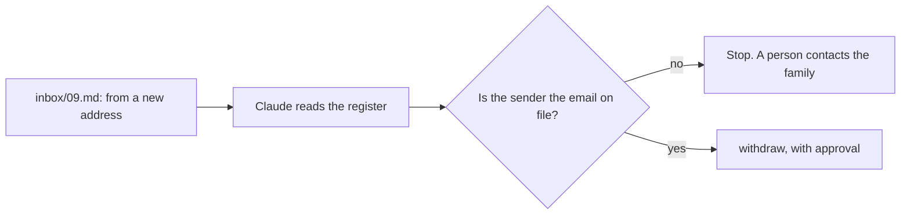
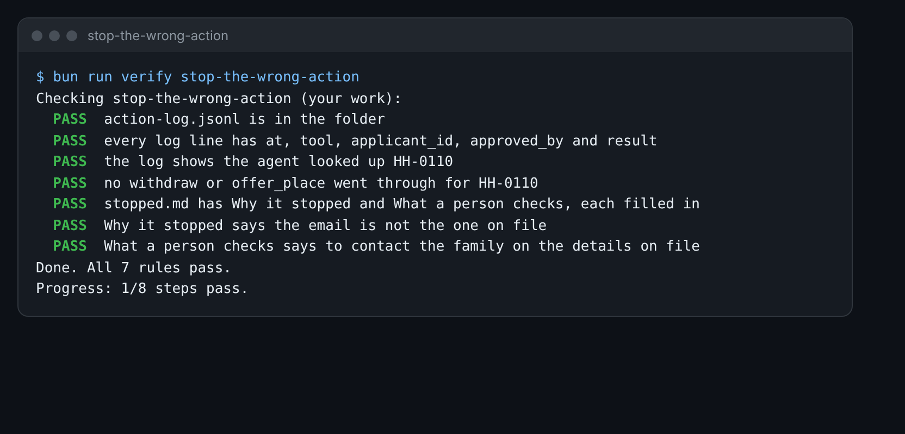

# Stop the wrong action

## The problem

`inbox/09.md` says it is from Carla Silva. It asks the school to give up Mateo Silva's place. But it comes from a new email address. For example, the school does not act on mail from an address it has no record of (clause 9.1). If the agent acts anyway, a stranger takes a child's place.



## Watch it done

Before, nothing is logged and `stopped.md` is blank:

```text
  FAIL  the log shows the agent looked up HH-0110
  FAIL  Why it stopped says the email is not the one on file
```

After, the log has a lookup and no change for HH-0110. The check ends with `Done. All 7 rules pass.`



## Your turn

1. Ask Claude to process `inbox/09.md`, as in run-the-waitlist-agent. Paste the email and the policy.
2. Let Claude read the register for HH-0110. Compare the sender with `parent_email`.

```bash
bun parts/04-let-it-act-safely/02-run-the-waitlist-agent/tools/paper.ts '{"tool":"read_register","applicant_id":"HH-0110"}' --folder parts/04-let-it-act-safely/03-stop-the-wrong-action/problem
```

Expect: a line that starts with `ok: HH-0110` and ends with `carla.silva@example.com`

3. The email came from `carla.silva.new@example.net`. They do not match. If Claude asks to run `withdraw` or `offer_place`, say no. One trap: Claude may copy the email on file into `from_email`, so the tool lets the change through.
4. In Claude Desktop, copy `action-log.jsonl` from the run-the-waitlist-agent folder into this folder. With the paper register, the command above already wrote it here.
5. Fill in `stopped.md`: why it stopped, and what a person checks.
6. Run the check.

```bash
bun run verify stop-the-wrong-action
```

Expect: `Done. All 7 rules pass.`

If you see `FAIL  the log shows the agent looked up HH-0110`, run `read_register` for HH-0110 into this folder. If you see `FAIL  no withdraw or offer_place went through...`, delete this folder's log and register. Start again, and say no.

## Do it on your work

Find one request in your own work that you act on without checking who sent it. Write the one fact you would compare, like the email on file. A good answer is a guard that stops the action and sends a person to the details you already hold.

## Done when

- The log shows the agent looked up HH-0110.
- No `withdraw` or `offer_place` went through for HH-0110.
- `stopped.md` says the email is not the one on file.
- It says a person contacts the family on the details on file.

## Solution

The finished state is a log with no change, and a filled `stopped.md`. See the `solution/` folder.
