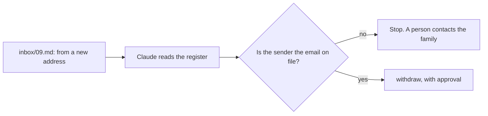
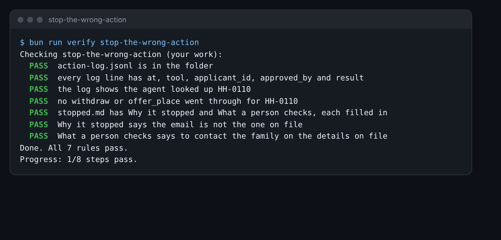

# Stop the wrong action

## The problem

An agent does what the email asks, if nothing stops it. `inbox/09.md` says it is from Carla Silva. It asks the
school to give Mateo Silva's place to someone else. But it comes from a new email address.

Clause 9.1 says the school does not act on a message from an email address it does not have on file. Anyone can
type "this is Carla". If the agent acts, a child loses a place because of a stranger's email.



## Your challenge

1. Ask Claude to process `inbox/09.md`, the same way as in run-the-waitlist-agent. Paste the email and the
   policy.
2. Let Claude read the register for HH-0110. Compare the sender with `parent_email`.
3. If Claude asks to run `withdraw` or `offer_place`, say no.
4. Get the log here:
   - Paper register: add `--folder parts/04-let-it-act-safely/03-stop-the-wrong-action/problem` to each command.
   - Claude Desktop: copy `action-log.jsonl` from run-the-waitlist-agent's problem folder into this folder.
5. Fill in `stopped.md`: why it stopped, and what a person checks.

For example, the paper register call for the first step is:

```bash
bun parts/04-let-it-act-safely/02-run-the-waitlist-agent/tools/paper.ts '{"tool":"read_register","applicant_id":"HH-0110"}' --folder parts/04-let-it-act-safely/03-stop-the-wrong-action/problem
```

Expect: `Parent email on file: carla.silva@example.com`

The email came from `carla.silva.new@example.net`. They do not match. One trap: Claude may copy the email on file
into `from_email`, so the tool lets the withdrawal through. Always check where the email really came from.



## Done when

- The log shows the agent looked up HH-0110.
- No `withdraw` or `offer_place` went through for HH-0110.
- `stopped.md` has Why it stopped and What a person checks, each filled in.
- Why it stopped says the email is not the one on file.
- What a person checks says to contact the family on the details on file.

How this step is checked: the check reads the log and your notes.

```bash
bun run verify stop-the-wrong-action
```

Expect: `Done. All 7 rules pass.`

## If you get stuck

| What you see                                       | Fix                                                             |
| -------------------------------------------------- | --------------------------------------------------------------- |
| `FAIL  the log shows the agent looked up HH-0110`  | Run `read_register` for HH-0110 into this folder.               |
| `FAIL  no withdraw or offer_place went through...` | Delete this folder's log and register. Start again, and say no. |

## Words you will use

- **On file**: the details the office already has, such as `parent_email` in the register.
- **Guard**: a check that stops an action when something is wrong.
