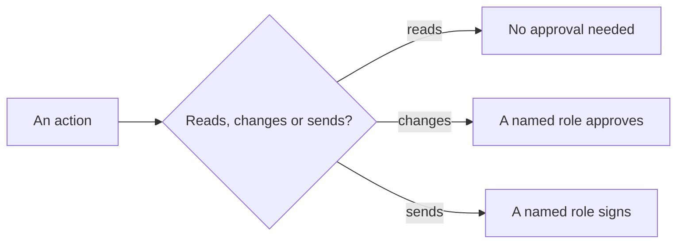
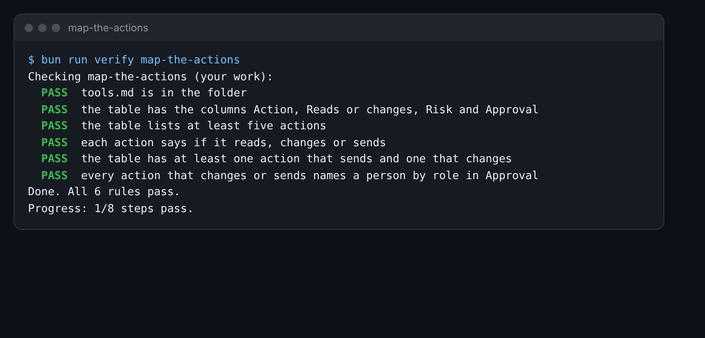

# Map the actions

This step is extra. Do it if you have time.

## The problem

Your agent had five tools. A real office would add more: send emails, change records, delete files. Before anyone adds a tool, someone must say how risky it is and who approves it. Without that map, the AI ends up approving its own changes.



## Watch it done

Before, the table has one row:

```text
  FAIL  the table lists at least five actions
  FAIL  the table has at least one action that sends and one that changes
```

After, every action has a risk and a named role. The check ends with `Done. All 6 rules pass.`



## Your turn

1. Open `tools.md` in this folder. It has one row to start.
2. Add a row for each action the office might give an AI. Think of read, draft, send, change the register, and delete.
3. In the Reads or changes column, write `reads`, `changes` or `sends`.
4. In the Risk column, say what could go wrong.
5. In the Approval column, name the job of the person who says yes. Write "none needed" only for an action that reads.

For example, here is the row for offering a place:

```text
| Offer a place | changes the register | high: the wrong child gets the place | Admissions Officer |
```

A role is a job, such as Admissions Officer. It names who, without naming one person. The AI never approves its own change.

6. Run the check.

```bash
bun run verify map-the-actions
```

Expect: `Done. All 6 rules pass.`

If you see `FAIL  every action that changes or sends names...`, write a job title. If you see `FAIL  the table has at least one action that sends...`, add a row for sending an email and one for the register.

## Do it on your work

Make the same table for the tools you would give an AI in your own work. A good answer has at least five actions, and a human role beside every one that changes or sends.

## Done when

- The table lists at least five actions.
- Each action says if it reads, changes or sends.
- At least one action sends and one changes.
- Every action that changes or sends names a role in Approval.

## Solution

The finished state is a filled `tools.md`. See `solution/tools.md`.
