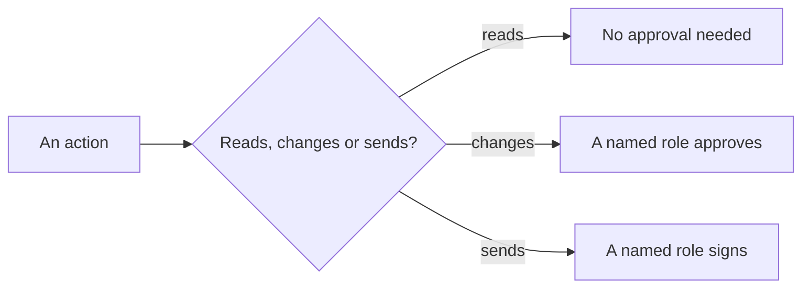
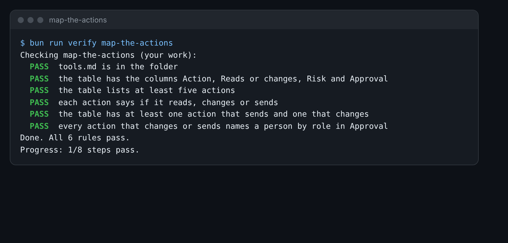

# Map the actions

This step is extra. Do it if you have time, or come back to it later.

## The problem

Your agent had five tools. A real office would give it more: send emails, change records, delete files. Before
anyone adds a tool, someone must say how risky it is and who approves it. Without that map, the AI ends up
approving itself.

Some actions only read. Reading cannot hurt a family. Some actions change the register or send a letter. Those
need a person, named by their job.



## Your challenge

Fill in the table in `tools.md` in this folder. It has one row to start.

1. Add a row for each action the office might give an AI. Think of read, draft, send, change the register, and
   delete.
2. In **Reads or changes**, write `reads`, `changes` or `sends`.
3. In **Risk**, say what could go wrong.
4. In **Approval**, name the job of the person who says yes. Write "none needed" only for an action that reads.

For example, here is the row for offering a place:

```text
| Offer a place | changes the register | high: the wrong child gets the place | Admissions Officer |
```

The AI never approves its own change. "None, the AI follows the list" is the mistake this step catches.



## Done when

- The table has the columns Action, Reads or changes, Risk and Approval.
- It lists at least five actions.
- Each action says if it reads, changes or sends.
- At least one action sends and one changes.
- Every action that changes or sends names a person by role in Approval.

How this step is checked: the check reads your table, row by row.

```bash
bun run verify map-the-actions
```

Expect: `Done. All 6 rules pass.`

## If you get stuck

| What you see                                            | Fix                                                       |
| ------------------------------------------------------- | --------------------------------------------------------- |
| `FAIL  every action that changes or sends names...`     | Write a job title, such as Admissions Officer.            |
| `FAIL  the table has at least one action that sends...` | Add a row for sending an email, and one for the register. |

## Words you will use

- **Read action**: an action that looks at data and changes nothing.
- **Write action**: an action that changes data or sends something out.
- **Role**: a job, such as Admissions Officer. It says who, without naming one person.
