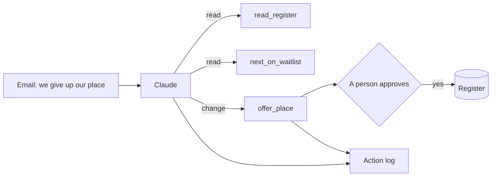

# Let it act safely

## After this part you can

Let an AI use tools on your records, with a person's name on every change.

## You leave with

An `action-log.jsonl` and `register.json` where every change has an approver, and a `stopped.md` for the email the agent refused.

## The problem

A family gives up its place. Then the waiting list moves up, the next child gets an offer, and a letter goes out. For example, Siobhan Brennan asks the school to withdraw the place for Leo Brennan (HH-0102). Now `bun run world` prints `Top of the waiting list: 1. HH-0116`. But clause 7.2 says the list is kept in policy order, so that may be wrong. An AI that does steps with tools is an agent. Only a person may offer a place. Qonto, a business bank, says its agents make transfers "2X faster". It also says "Any action with a financial or customer relationship impact requires user confirmation" ([Qonto's story on claude.com](https://claude.com/customers/qonto)). The AI acts, and a person says yes. Every action goes into an action log.



## Steps

You work in Claude.ai or Claude Desktop, and save each answer in the step's `problem` folder. The last step is extra. The office tools live in `02-run-the-waitlist-agent/tools/`. If you cannot install Claude Desktop, the paper register runs the same tools by hand.

| Step                                                                  | What you hand in                       | What the check reads                                                             |
| --------------------------------------------------------------------- | -------------------------------------- | -------------------------------------------------------------------------------- |
| [be-the-tool](01-be-the-tool/problem/README.md)                       | `tool-calls.md`                        | each tool call in order, the right next child, where you would stop it           |
| [run-the-waitlist-agent](02-run-the-waitlist-agent/problem/README.md) | `action-log.jsonl` and `register.json` | the right withdrawal and offer, a name on every change, the list in policy order |
| [stop-the-wrong-action](03-stop-the-wrong-action/problem/README.md)   | `action-log.jsonl` and `stopped.md`    | no change for the fake email, and why it stopped                                 |
| [map-the-actions](04-map-the-actions/problem/README.md) (go further)  | `tools.md`                             | every action, its risk, and who approves it                                      |

This command runs one tool by hand, the paper register way. It reads one row of the register:

```bash
bun parts/04-let-it-act-safely/02-run-the-waitlist-agent/tools/paper.ts '{"tool":"read_register","applicant_id":"HH-0137"}'
```

Expect: a line that starts with `ok: HH-0137 Zara Ahmed: waitlisted, position 22 (sibling, clause 4.3, 3.9 km).`

```bash
bun run verify be-the-tool
```

Expect: `Done. All 5 rules pass.` once `tool-calls.md` is filled in.

```bash
bun run verify run-the-waitlist-agent
```

Expect: `Done. All 8 rules pass.` once the agent has processed `inbox/07.md`.

```bash
bun run verify stop-the-wrong-action
```

Expect: `Done. All 7 rules pass.` once the log and `stopped.md` are in place.

```bash
bun run verify map-the-actions
```

Expect: `Done. All 6 rules pass.` once `tools.md` is filled in.

```bash
bun run verify part let-it-act-safely
```

Expect: `Part let-it-act-safely is done: 4/4 steps pass.`

Want to see a right answer first? Add the word `solution` after a step name. For example, `bun run verify run-the-waitlist-agent solution` checks the sample log.

## Watch and read

| Kind | Title                                  | Author         | Why                                                      | Link                                                                                    |
| ---- | -------------------------------------- | -------------- | -------------------------------------------------------- | --------------------------------------------------------------------------------------- |
| read | Building effective agents              | Anthropic      | What an agent is, and why simple steps beat clever ones. | https://www.anthropic.com/engineering/building-effective-agents                         |
| read | Our framework for safe agents          | Anthropic      | Why a person keeps control and approves the risky steps. | https://www.anthropic.com/news/our-framework-for-developing-safe-and-trustworthy-agents |
| read | Writing effective tools for agents     | Anthropic      | How to design tools an agent uses well.                  | https://www.anthropic.com/engineering/writing-tools-for-agents                          |
| read | Tool use with Claude                   | Anthropic docs | How Claude asks for a tool and gets the result back.     | https://docs.claude.com/en/docs/agents-and-tools/tool-use/overview                      |
| read | Introducing the Model Context Protocol | Anthropic      | The standard behind the office tools in Claude Desktop.  | https://www.anthropic.com/news/model-context-protocol                                   |

## Project

Pick one task in your own work that an AI could do with tools. List each tool, and name who approves every change.
